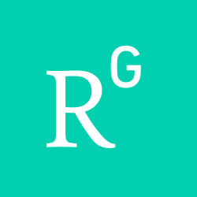

<!-- markdownlint-disable MD033 -->
 The papers live in _data/publications.yml: adding a paper is one entry there. 






I'm the author of academic papers published in reputable journals and conferences. The following is an updated list of my published work (in reverse chronological order).

<ul class="pub-profiles" aria-label="Publication profiles">
   <li><a href="https://scholar.google.es/citations?user=jNBoowwAAAAJ&amp;hl=en">Google Scholar</a></li>
   <li><a href="https://orcid.org/0000-0003-0541-6411">ORCID 0000-0003-0541-6411</a></li>
   <li><a href="https://dblp.uni-trier.de/pers/hd/s/Soto=Valero:C=eacute=sar">dblp</a></li>
   <li><a href="https://www.researchgate.net/profile/Cesar_Soto-Valero">ResearchGate</a></li>
</ul>

<nav class="blog-filters pub-filters" aria-label="Filter papers by type">
   <ul>
      <li><button type="button" class="blog-filter" data-filter="" aria-pressed="true">All {{ pubs.size }}</button></li>
      <li><button type="button" class="blog-filter" data-filter="journal" aria-pressed="false">Journal {{ journals.size }}</button></li>
      <li><button type="button" class="blog-filter" data-filter="conference" aria-pressed="false">Conference {{ conferences.size }}</button></li>
      <li><button type="button" class="blog-filter" data-filter="thesis" aria-pressed="false">Thesis {{ theses.size }}</button></li>
      <li><button type="button" class="blog-filter" data-filter="award" aria-pressed="false">Awarded {{ awarded.size }}</button></li>
   </ul>
   

</nav>



<section class="pub-year" data-year="{{ group.name }}">
   <h2 class="blog-year-title" id="y{{ group.name }}">{{ group.name }}</h2>
   <ol class="pub-list">
      
      
      <li class="pub" data-type="{{ pub.type }}" data-award="true">
         
{{ type_label }} {{ pub.title }}

         
{{ pub.authors | replace: "César Soto-Valero", "<strong>César Soto-Valero</strong>" }}

         
<em>{{ pub.venue }}</em>. {{ pub.note }}

         
<i class="fas fa-award" aria-hidden="true"></i> {{ pub.award }}

         
         <ul class="pub-links" aria-label="Links for {{ pub.title | escape }}">
            <li><a href="{{ link.url }}">{{ link.label }}</a></li>
         </ul>
         
      </li>
      
   </ol>
</section>


