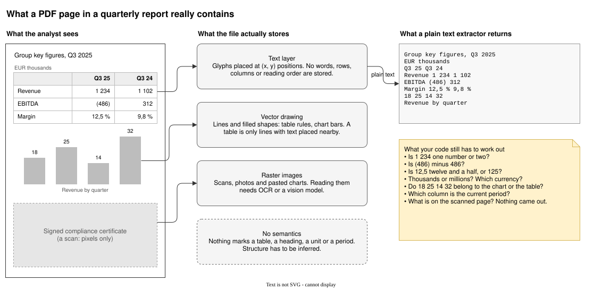
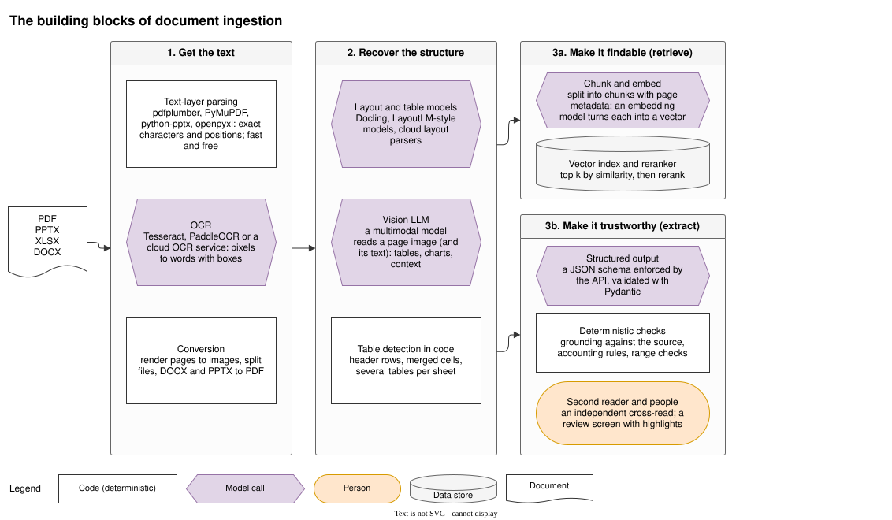
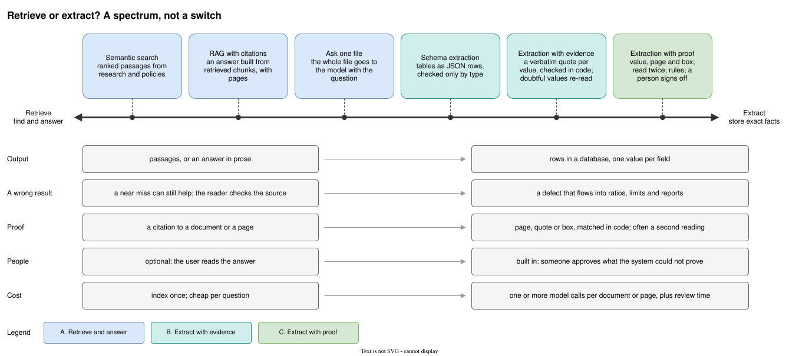
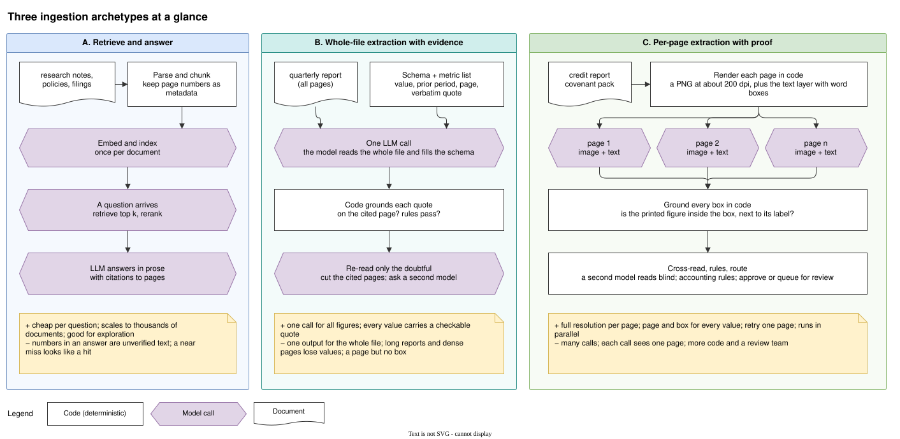
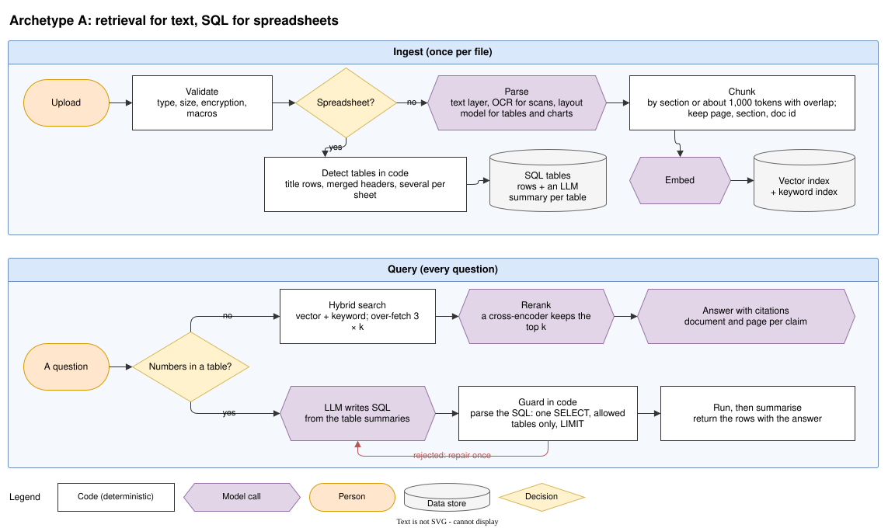
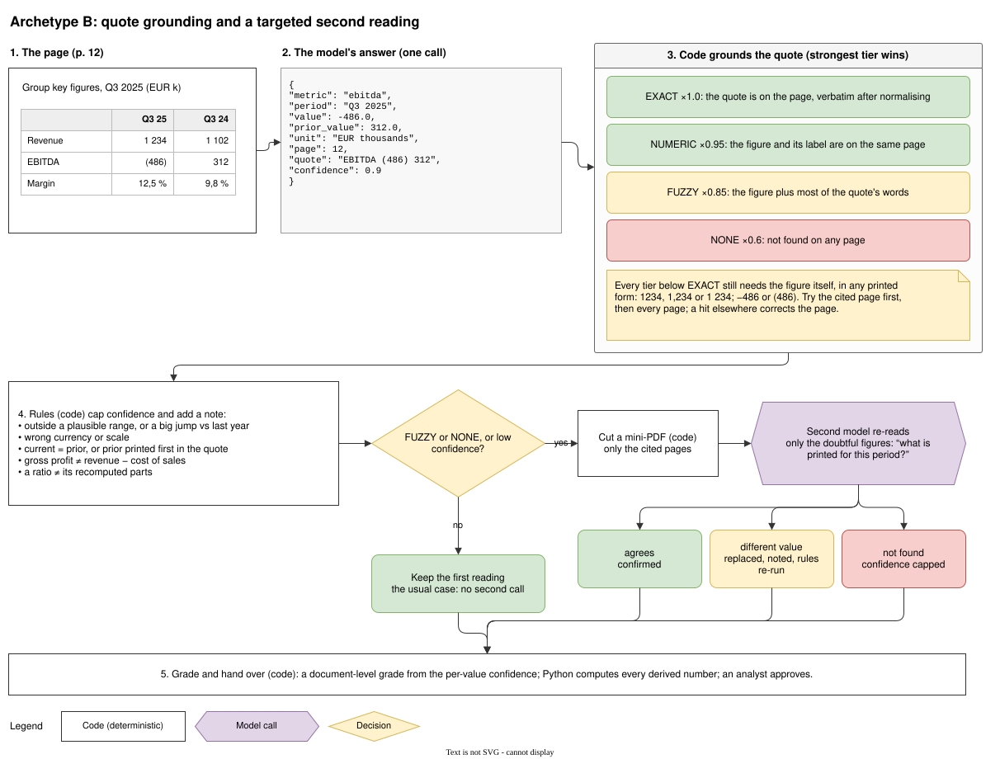
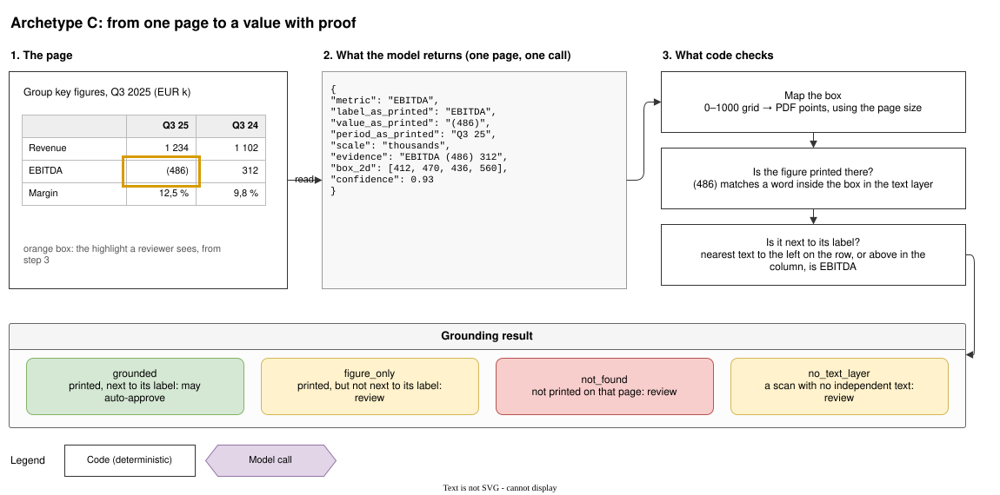
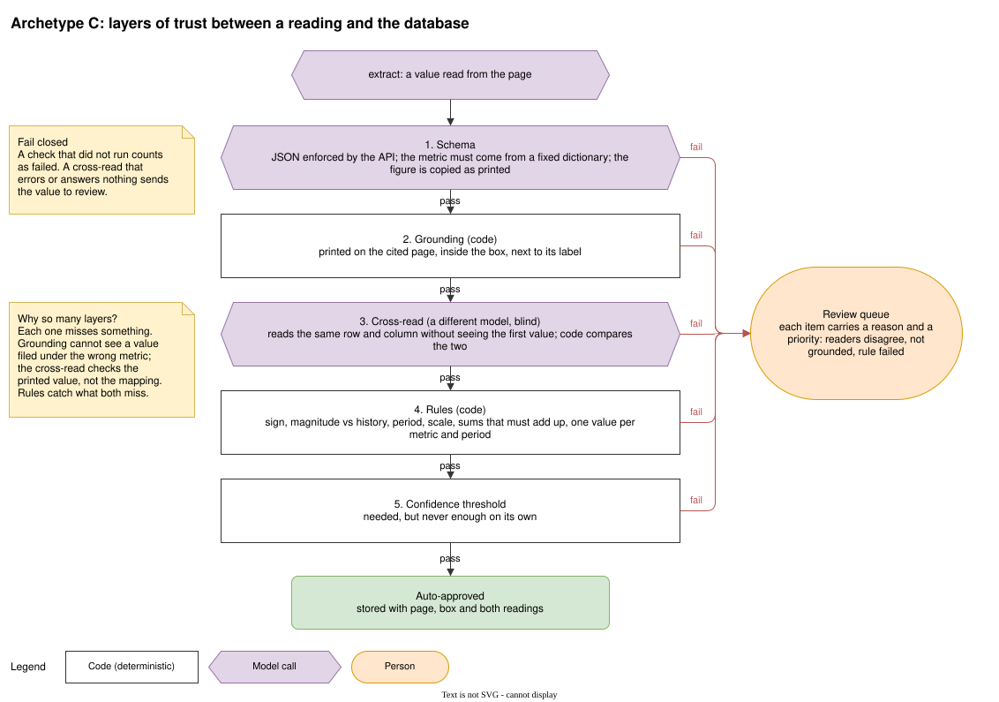
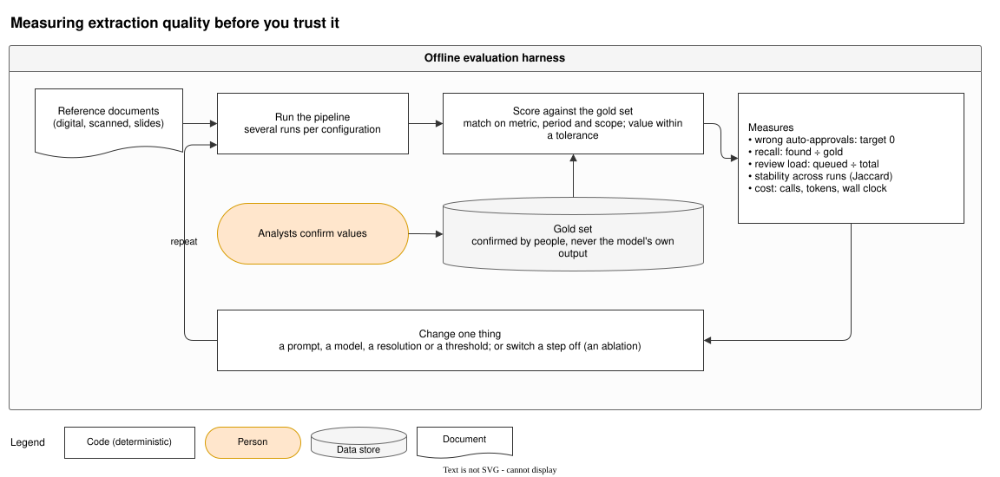
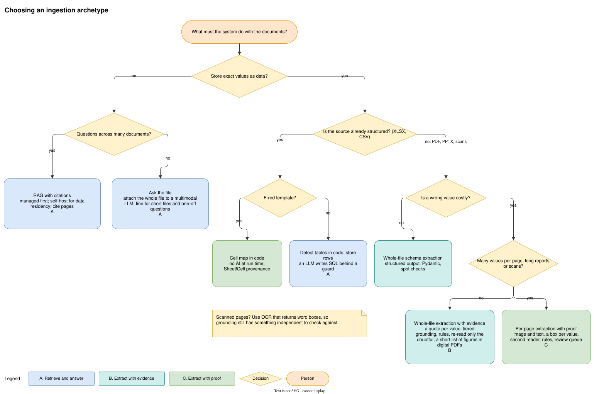

Every quarter, a corporate borrower sends its bank a PDF.
Somewhere around page 12, there is a small table with a number in brackets: **(486)**.
That is EBITDA, in thousands of euros, and it is negative.
A credit analyst copies it into a spreadsheet, recomputes net debt to EBITDA, and checks the result against the covenant in the loan agreement.
If the ratio breaches the threshold, the bank and the borrower are about to have a difficult conversation.

Now imagine an AI system reads that PDF instead.
It sees "(486)" and stores `486`.
The sign has flipped.
The leverage ratio looks healthy, the covenant passes, and nobody notices.

<aside class="quote">
    <em>“In finance, a wrong number that looks right is worse than no number at all.”</em>
</aside>

Most document-AI demos show a chatbot answering questions about a PDF.
That is nice, but it is not the problem banks have most of the time.
The everyday problem is turning documents into **useful data** (i.e., values that flow into credit models, risk limits, and regulatory reports, where a near miss is a defect).
Multimodal LLMs made the reading part dramatically easier.
They did not make the *trusting* part any easier.

I have spent a good part of the last year building and comparing document ingestion pipelines in the financial sector.
This post distills what I learned into a vendor-neutral guide for AI engineers.
I'll cover:

1. Why financial documents are hard for AI, and the specific traps that I've seen breaking real-world pipelines.
2. Retrieval vs. extraction: the single decision that shapes everything else.
3. Three architecture archetypes, from RAG to per-page extraction with proof, with Python code for the parts that matter.
4. How to measure quality and how to pick the right archetype for your use case.

<figure class="jb_picture">
  {% responsive_image width: "100%" border: "0px solid #808080" path: img/posts/2026/2026-11-11/konstantinopel.jpg alt: "Bronze horse sculpture Konstantinopel (Hästen) by Sivert Lindblom at Blasieholmstorg, Stockholm" %}
  <figcaption class="stroke">
   &#169; A faithful copy is only as trustworthy as your ability to trace it back to the original. Photo taken at Blasieholmstorg, a historic square in central Stockholm, near Kungsträdgården. The bronze horse is <em>Konstantinopel (Hästen)</em>, created by Swedish artist <a href="https://en.wikipedia.org/wiki/Sivert_Lindblom">Sivert Lindblom</a> in 1989. It is a replica of one of the <a href="https://en.wikipedia.org/wiki/Horses_of_Saint_Mark">Horses of Saint Mark</a> in Venice, whose history traces back to Constantinople and the Fourth Crusade in 1204.
  </figcaption>
</figure>

# Why Financial Documents Are Hard

A PDF is not a document in the way you as a human amy think of it.
It is a set of drawing instructions: put this glyph at these coordinates, draw a line from here to there, paint this image in that rectangle etc..
There is no "table", no "row", no "column header".
Those are things *you* see, because your brain groups the glyphs.

<figure class="jb_picture">
  
  <figcaption class="stroke">
    Figure 1. What the analyst sees, what the PDF file stores, and what a plain text extractor returns. Every question in the yellow note is something your code still has to answer.
  </figcaption>
</figure>

Financial reports add their own traps on top of that:

- **Accounting notation.** Negative values are printed in parentheses: `(486)` means −486. A dash can mean zero or "not applicable".
- **Locale.** `1 234` is one number with a space as thousands separator. `12,5 %` uses a decimal comma. The same report may mix both conventions.
- **Scale and currency.** A header says "EUR thousands" once, and every number on the page inherits it. Miss the header and you are off by a factor of 1,000.
- **Periods.** Most tables show the current period next to a comparative one. Pick the wrong column and you get last year's number, which is plausible and therefore dangerous.
- **Layout.** Merged headers, multi-page tables, footnote markers glued to numbers (`1 234¹`), and key figures that only appear inside a chart.
- **Scans.** Signed compliance certificates and older annexes are often images with no text layer at all.
- **Slides and spreadsheets.** Investor presentations put numbers in charts and text boxes with no reading order. Excel files are not documents at all: they are small programs with formulas, hidden sheets, and several tables per tab.

None of this is exotic.
It is what a normal quarter looks like for a credit, research, or KYC team.

# The Building Blocks

Every ingestion pipeline I have seen is assembled from the same handful of components.
What differs is how they are combined, and which one is trusted to have the last word.

<figure class="jb_picture">
  
  <figcaption class="stroke">
    Figure 2. The building blocks of document ingestion. White boxes are deterministic code, purple boxes are model calls. Steps 1 and 2 are shared; step 3 splits into retrieval or extraction.
  </figcaption>
</figure>

**1. Get the text.**
Text-layer parsers such as [pdfplumber](https://github.com/jsvine/pdfplumber) and PyMuPDF[^1] give you the exact characters and their positions, quickly and for free.
For scanned pages you need OCR, either open source (Tesseract, PaddleOCR) or a managed service such as Amazon Textract[^2] or Google Document AI[^3], which also return word-level bounding boxes.
You will also need plain conversion utilities: rendering pages to images, splitting files, and converting PPTX and DOCX to PDF.

**2. Recover the structure.**
Layout-aware models learn from text, position, and pixels together.
The LayoutLM family[^4] [^5] pioneered this, and open toolkits like Docling[^6] package layout analysis and table structure recognition into a usable pipeline.
More recently, multimodal LLMs read a page image (and its text) directly and return whatever structure you ask for.
For spreadsheets, structure recovery is mostly deterministic code: finding header rows, merged cells, and multiple tables per sheet.

**3a. Make it findable.**
Split the content into chunks, embed each chunk, and store the vectors with their page numbers.
At query time, retrieve the top *k* chunks and rerank them.
This is retrieval-augmented generation (RAG)[^7].

**3b. Make it trustworthy.**
Ask a model for typed fields through a schema the API enforces, then check every value in code against the source.
Add a second, independent reading and a human review step for whatever the code cannot prove.

# Retrieval or Extraction?

This is the most important design decision, and teams often make it implicitly.

**Retrieval** answers questions.
The output is a passage or an answer in prose, and a human reads it.
If the system returns a slightly wrong passage, the reader usually notices, and a citation lets them check.

**Extraction** produces data.
The output is a row in a database, one value per field, and nobody reads it again until it is aggregated into a ratio, a limit utilisation, or a regulatory return.
A wrong value is not a bad answer: it is a data-quality incident.

<figure class="jb_picture">
  
  <figcaption class="stroke">
    Figure 3. Retrieval and extraction are two ends of a spectrum. Moving right buys stronger guarantees on each value at the cost of more model calls, more code, and a review process.
  </figcaption>
</figure>

In banking terms, the split usually looks like this:

- **Retrieve:** research assistants over broker notes and filings, policy and procedure Q&A, "what did the borrower say about refinancing?" questions.
- **Extract:** financial spreading for credit analysis, covenant monitoring, KYC data capture, term-sheet terms into a booking system, anything that feeds a model or a regulatory report.

Regulators care about the second category.
BCBS 239 asks banks to produce risk data that is accurate, complete, and traceable to its source[^8].
Model risk guidance such as the Federal Reserve's SR 11-7 expects models (and an LLM extracting inputs to a credit model qualifies as part of the model) to be validated and monitored[^9].
And if your use case involves the creditworthiness of individuals, the EU AI Act classifies it as high-risk[^10].
"The LLM said so" will not survive any of those conversations.

# Three Ingestion Archetypes

Across the systems I have built and reviewed, three archetypes keep showing up.
They are not products.
They are patterns, and real systems often combine them.

<figure class="jb_picture">
  
  <figcaption class="stroke">
    Figure 4. The three archetypes at a glance. A is built for questions, B and C for data. B makes one model call per document; C makes at least one per page.
  </figcaption>
</figure>

## Retrieve and Answer (A)

This is the familiar RAG pipeline, with one twist that matters a lot in finance: spreadsheets take a different path.

<figure class="jb_picture">
  
  <figcaption class="stroke">
    Figure 5. Archetype A. Text goes through chunking and a vector index. Spreadsheets become SQL tables, and a guard in code checks every LLM-written query before it runs.
  </figcaption>
</figure>

On the text side, a few details separate a good pipeline from a demo:

- **Keep provenance in metadata.** Every chunk carries its document id, page, and section. Without it, you cannot cite, and an answer without a citation is an opinion.
- **Chunk by structure, not by character count.** Split on sections and keep tables whole when you can. A table cut in half produces numbers without headers.
- **Use hybrid search.** Embeddings are weak at exact tokens such as ISINs, covenant names, or "Q3 2025". Combine vector search with a keyword index, over-fetch a few times *k*, and let a cross-encoder rerank.
- **Consider retrieving pages, not text.** For visually rich documents, ColPali-style models embed page images directly and skip OCR at retrieval time[^11].

On the spreadsheet side, embedding cells is a mistake.
A question like "what was the total exposure to the retail sector?" needs a `SUM`, not a similarity search.
Detect the tables in code, store them as rows, and let the LLM write SQL against a short summary of each table.
Then **guard the SQL in code** before it runs: parse it (for example, with `sqlglot`), accept exactly one `SELECT` statement, allow only known tables, and force a `LIMIT`.
If the guard rejects the query, give the model one chance to repair it, then stop.

Archetype A is cheap per question and scales to thousands of documents.
Its limit is in the output: a number inside a prose answer is unverified text.
If you need that number in a database, you need archetype B or C.

## Whole-File Extraction with Evidence (B)

Archetype B sends the whole document to a multimodal model in one call and asks for a fixed list of metrics.
The key idea is that the model must return **evidence** with every value: the page it read it from and a verbatim quote of the printed line.
Code then checks the evidence.

<figure class="jb_picture">
  
  <figcaption class="stroke">
    Figure 6. Archetype B. One model call extracts every metric with a quote. Code grounds each quote, rules cap confidence, and only doubtful values are re-read by a second model on the cited pages.
  </figcaption>
</figure>

Start with a strict schema.
Modern LLM APIs can enforce a JSON schema at decoding time, so the response always parses[^12].
With Pydantic[^13], the schema and the validator are the same object:


from typing import Literal
from pydantic import BaseModel, Field
from google import genai
from google.genai import types

Metric = Literal["revenue", "ebitda", "net_debt", "interest_expense"]

class ExtractedValue(BaseModel):
    metric: Metric
    period: str = Field(description="Period as printed, e.g. 'Q3 2025'")
    value: float | None = Field(description="Current period, signed: (486) is -486")
    prior_value: float | None = Field(description="Comparative period, if printed")
    unit: str = Field(description="Currency and scale, e.g. 'EUR thousands'")
    page: int = Field(ge=1, description="1-based page where the value is printed")
    quote: str = Field(description="The printed line, copied verbatim")
    confidence: float = Field(ge=0, le=1)

class Extraction(BaseModel):
    values: list[ExtractedValue]

client = genai.Client()
response = client.models.generate_content(
    model=MODEL,
    contents=[types.Part.from_bytes(data=pdf_bytes, mime_type="application/pdf"), PROMPT],
    config=types.GenerateContentConfig(
        response_mime_type="application/json",
        response_schema=Extraction,
        temperature=0,
    ),
)
extraction = Extraction.model_validate_json(response.text)


Notice what the schema does *not* contain: margins, ratios, growth rates.
**The model reads; Python does the arithmetic.**
Every derived number is computed in code from extracted inputs, so it is reproducible and testable.

A schema guarantees the *shape* of the answer, not its truth.
The next step is to ground each quote against the text layer of the PDF.
I use tiers, because "the quote is not on the page" has many causes, some harmless (a line break, a non-breaking space) and some not (a hallucination):


import re
from enum import Enum
from itertools import takewhile

class Tier(Enum):
    EXACT = 1.0     # the quote is on the page, verbatim after normalising
    NUMERIC = 0.95  # the figure and its label are on the same page
    FUZZY = 0.85    # the figure plus most of the quote's words
    NONE = 0.6      # not found anywhere

def normalise(text: str) -> str:
    text = text.replace("\u00a0", " ").replace("\u202f", " ").replace("\u2212", "-")
    return re.sub(r"\s+", " ", text).strip().lower()

def printed_forms(value: float) -> set[str]:
    """Return the ways a report may print this number."""
    digits = f"{abs(value):,.0f}" if float(value).is_integer() else f"{abs(value):,.1f}"
    forms = {
        digits,                                       # 1,234 or 12.5
        digits.replace(",", ""),                      # 1234
        digits.replace(",", " "),                     # 1 234
        digits.translate(str.maketrans(",.", ".,")),  # 1.234 or 12,5
    }
    if value < 0:
        forms = {f"({f})" for f in forms} | {f"-{f}" for f in forms}
    return forms

def has_number(page: str, form: str) -> bool:
    return re.search(rf"(?<!\d){re.escape(form)}(?!\d)", page) is not None

def has_digit(word: str) -> bool:
    return any(c.isdigit() for c in word)

def ground(v: ExtractedValue, pages: list[str]) -> tuple[Tier, int]:
    """Return the strongest tier found and the page it was found on."""
    quote = normalise(v.quote)
    words = [w for w in quote.split() if not has_digit(w)]
    label = list(takewhile(lambda w: not has_digit(w), quote.split()))  # "ebitda"
    order = [v.page - 1] + [i for i in range(len(pages)) if i != v.page - 1]
    best = (Tier.NONE, v.page)
    for i in (i for i in order if 0 <= i < len(pages)):
        page = normalise(pages[i])
        if quote and quote in page:
            return Tier.EXACT, i + 1
        if v.value is None or not any(has_number(page, f) for f in printed_forms(v.value)):
            continue
        if label and all(w in page for w in label):
            tier = Tier.NUMERIC
        elif words and sum(w in page for w in words) / len(words) >= 0.6:
            tier = Tier.FUZZY
        else:
            continue
        if tier.value > best[0].value:
            best = (tier, i + 1)
    return best


Two details are worth stealing.
First, every tier below `EXACT` still requires the figure itself, in any of its printed forms, so a quote that merely sounds right does not pass.
Second, the search starts on the cited page and then tries every other page: if the figure is found elsewhere, the page reference is corrected rather than discarded.
The tier multiplies the model's self-reported confidence, which on its own is poorly calibrated and should never be the only signal.

After grounding, deterministic **rules** cap confidence and attach a note: a value outside a plausible range, a big jump against last period, current equal to prior, a wrong currency, gross profit that does not equal revenue minus cost of sales.

Only then does the expensive part run, and only for doubtful values.
Code cuts a mini-PDF containing just the cited pages, and a *second* model is asked a narrow question: "what is printed for this metric and period?"
If it agrees, the value is confirmed.
If it disagrees, the value is replaced and flagged.
If it finds nothing, confidence is capped.
Most documents never need the second call.

Archetype B is elegant and cheap: one call for all the figures, with evidence for each.
Its weaknesses come from that same single call.
Long reports strain attention, and models are known to use the middle of a long context less reliably than its edges[^14].
Dense pages with dozens of values lose some of them.
And a quote gives you a page, not a location on it, so a reviewer still has to hunt for the number.

## Per-Page Extraction with Proof (C)

Archetype C inverts the trade-off.
Code renders every page as an image (around 200 dpi is a good default) and pairs it with that page's text layer.
Each page goes to the model in its own call, so the model sees the page at full resolution and the calls run in parallel.
The model returns each value **as printed**, plus a bounding box around it.

<figure class="jb_picture">
  
  <figcaption class="stroke">
    Figure 7. Archetype C. The model returns the figure as printed and a bounding box; code maps the box to PDF points, checks the figure is printed inside it, and checks its label sits on the same row. The orange box is what a reviewer will see.
  </figcaption>
</figure>

Asking for the value *as printed* (`"(486)"`, not `-486`) matters.
It keeps reading separate from interpretation, so sign, scale, and locale are applied by code you can test.

Gemini, for example, returns boxes as `[ymin, xmin, ymax, xmax]` normalised to a 0–1000 grid[^15].
Because the grid is relative to the image, mapping it back to PDF coordinates only needs the page size, regardless of the rendering resolution.
With PyMuPDF[^1]:


import fitz  # PyMuPDF

def render(page: fitz.Page, dpi: int = 200) -> bytes:
    return page.get_pixmap(dpi=dpi).tobytes("png")

def box_to_rect(box_2d: list[int], page: fitz.Page) -> fitz.Rect:
    """Map a [ymin, xmin, ymax, xmax] box on a 0-1000 grid to PDF points."""
    ymin, xmin, ymax, xmax = box_2d
    w, h = page.rect.width, page.rect.height
    return fitz.Rect(xmin * w / 1000, ymin * h / 1000, xmax * w / 1000, ymax * h / 1000)

def ground_box(value_as_printed: str, label: str, box_2d: list[int], page: fitz.Page) -> str:
    words = page.get_text("words")  # (x0, y0, x1, y1, text, block, line, word_no)
    if not words:
        return "no_text_layer"
    rect = box_to_rect(box_2d, page) + (-3, -3, 3, 3)  # a little tolerance
    inside = " ".join(w[4] for w in words if fitz.Rect(w[:4]).intersects(rect))
    if normalise(value_as_printed) not in normalise(inside):
        return "not_found"
    mid_y = (rect.y0 + rect.y1) / 2
    row = sorted((w for w in words if w[1] <= mid_y <= w[3] and w[2] <= rect.x0),
                 key=lambda w: w[0])
    left_of_value = normalise(" ".join(w[4] for w in row))
    return "grounded" if normalise(label) in left_of_value else "figure_only"


Note that the figure is matched on the *joined* words inside the box.
A text layer often splits `1 234` into two words, `1` and `234`, so matching word by word fails on exactly the numbers you care about.
A production version also checks the column header above the value (to confirm the period) and handles rotated pages and crop boxes, which are worth a dedicated test each.

The result is one of four states: `grounded` (printed, next to its label), `figure_only` (printed, but the label is elsewhere), `not_found`, or `no_text_layer` (a scan, so there is nothing independent to check against; run OCR with word boxes and ground against that instead).

Grounding is strong, but it is not enough on its own.
It cannot tell you that a correctly printed value was filed under the wrong metric.
So archetype C stacks several independent checks between a reading and the database:

<figure class="jb_picture">
  
  <figcaption class="stroke">
    Figure 8. Layers of trust in archetype C. Each layer catches something the others miss; a failure anywhere routes the value to a review queue with a reason. The system fails closed.
  </figcaption>
</figure>

1. **Schema.** The API enforces the JSON shape, and the metric must come from a fixed dictionary.
2. **Grounding.** The code above.
3. **Blind cross-read.** A *different* model reads the same row and column without seeing the first answer. Code compares the two. Using a different model family reduces correlated mistakes.
4. **Rules.** Sign conventions, magnitude against history, period and scale consistency, sums that must add up, and exactly one value per metric and period.
5. **Confidence threshold.** Necessary, never sufficient.

The most important property is in the caption: **fail closed**.
A check that did not run counts as failed.
A cross-read that times out sends the value to review instead of letting it through.
The review queue is not an afterthought; it is a product.
Each item carries its reason and a priority, and the reviewer sees the page with the box highlighted, so confirming a value takes seconds.
Every decision is stored with the page, the box, both readings, and the reviewer, which is exactly the lineage BCBS 239 asks for.

The costs are real: many more model calls, more code, and a team that owns the review queue.
For documents where a wrong number moves money, I think that is the right trade.

# Spreadsheets Deserve Their Own Path

Do not send spreadsheets through a PDF pipeline.
Converting a workbook to images throws away the one advantage it has: the values are already data.

If the spreadsheet follows a **fixed template**, as many borrower reporting packs and regulatory templates do, skip the AI at run time entirely.
Use a model (or an analyst) once to propose a cell map, review it, version it, and let code read it every time:


from openpyxl import load_workbook

CELL_MAP = {  # proposed once, reviewed, versioned with the template
    "revenue": "P&L!D12",
    "ebitda": "P&L!D18",
    "net_debt": "Balance!F40",
}

def read_template(path: str) -> dict[str, tuple[float | None, str]]:
    """Return each metric with its value and Sheet!Cell provenance."""
    wb = load_workbook(path, data_only=True)
    out = {}
    for metric, ref in CELL_MAP.items():
        sheet, cell = ref.split("!")
        out[metric] = (wb[sheet][cell].value, ref)
    return out


One caveat: `data_only=True` returns the values Excel cached the last time the file was saved[^16].
A workbook generated by a script and never opened in Excel has no cached values, so formulas come back as `None`.
Treat `None` as "not computed", never as zero.

If the spreadsheet is **free-form**, detect the tables in code (title rows, merged headers, several tables per sheet) and use archetype A's SQL path for questions, or have a model map the detected tables to your schema once per layout.
Either way, every value keeps a `Sheet!Cell` reference, which is the spreadsheet equivalent of a page and a box.

# Measuring Quality

You cannot pick an archetype, a model, or a threshold without measuring.
And you cannot measure without a **gold set**: a few dozen representative documents (digital, scanned, slides) whose values have been confirmed by people.
Never use the model's own output as the gold set, not even "after a quick check".

<figure class="jb_picture">
  
  <figcaption class="stroke">
    Figure 9. The offline evaluation harness. Change one thing at a time, run several times per configuration, and track the measures that matter to the business.
  </figcaption>
</figure>

Match predictions to gold on metric, period, and scope, and compare values within a small tolerance.
Then track:

- **Wrong auto-approvals.** Values the system approved without review that are wrong. This is the bank's real risk metric, and the target is zero.
- **Recall.** The share of gold values found at all.
- **Review load.** The share of values sent to people. This is your operating cost.
- **Stability.** LLMs are not deterministic, even at temperature zero. Run each configuration several times and compare the outputs.
- **Cost.** Calls, tokens, and wall-clock time per document.

A minimal harness fits in a few lines:


from typing import NamedTuple

class Key(NamedTuple):
    doc: str
    metric: str
    period: str

def close(a: float, b: float, rel: float = 0.005) -> bool:
    return abs(a - b) <= rel * max(1.0, abs(b))

def score(pred: dict[Key, tuple[float, bool]], gold: dict[Key, float]) -> dict[str, float]:
    """pred maps each key to (value, auto_approved)."""
    found = [k for k in gold if k in pred and close(pred[k][0], gold[k])]
    auto = [k for k, (_, approved) in pred.items() if approved]
    # an auto-approved key that is not in a complete gold set is also wrong
    wrong = [k for k in auto if k not in gold or not close(pred[k][0], gold[k])]
    return {
        "recall": len(found) / len(gold),
        "wrong_auto_approvals": len(wrong),
        "review_load": 1 - len(auto) / max(len(pred), 1),
    }

def stability(run_a: set[tuple[Key, float]], run_b: set[tuple[Key, float]]) -> float:
    """Jaccard similarity of two runs' (key, value) pairs."""
    return len(run_a & run_b) / max(len(run_a | run_b), 1)


Use the harness for ablations too.
Switch off the cross-read, or drop the rendering resolution, and see which measure moves.
If removing a layer changes nothing, it is cost without benefit.
If it changes wrong auto-approvals, you have found a load-bearing layer.

# Which Archetype Should You Pick?

Start from what the system must *do* with the documents, not from the technology.

<figure class="jb_picture">
  
  <figcaption class="stroke">
    Figure 10. A decision guide. Colours match the archetypes: blue for A, teal for B, green for C. Most real systems combine more than one path.
  </figcaption>
</figure>

A few rules of thumb from experience:

- **Questions over many documents:** archetype A. Invest in provenance metadata and hybrid search before you invest in a bigger model.
- **A short, fixed list of figures from digital PDFs,** where a reviewer will look anyway: archetype B. It is the best value per model call.
- **Many values per page, long reports, scans, or values that feed credit and risk decisions:** archetype C. Pay for the proof.
- **Templates:** no AI at run time. A cell map is faster, cheaper, and auditable by construction.

Before you ship, check the pipeline against this list:

- [ ] Every stored value has provenance: document, page, and box (or `Sheet!Cell`).
- [ ] The model reads values as printed; sign, scale, and units are applied in code.
- [ ] Every derived number (ratios, margins, sums) is computed in code.
- [ ] The system fails closed: an error or a skipped check routes to review.
- [ ] Wrong auto-approvals are measured on a human-confirmed gold set, and the threshold is set from that measurement.
- [ ] Model and prompt versions are stored with each value, so results can be reproduced.
- [ ] Model risk and data governance teams have seen the design before go-live, not after.

# Conclusion

Multimodal LLMs turned financial document reading from a research problem into an API call.
That is great news, and also a trap: it makes it easy to build a pipeline that is impressive in a demo and unaccountable in production.

Here's the 5 core lessons from this post:

1. **Decide whether you retrieve or extract before you choose any tool.** They are different products with different failure modes.
2. **Never store a number you cannot point to.** A quote is good; a page and a box are better.
3. **Let the model read and let code decide.** Grounding, arithmetic, rules, and routing belong in deterministic code you can test.
4. **Fail closed, and design the review queue as part of the product.** People are a layer of the system, not an escape hatch.
5. **Measure wrong auto-approvals, not accuracy.** In finance, the expensive error is the confident one.

The model will keep getting better.
However, the need to prove where a number came from will not go away anytime soon.

# Footnotes

[^1]: Artifex, [_PyMuPDF documentation_](https://pymupdf.readthedocs.io/en/latest/).

[^2]: Amazon Web Services, [_What is Amazon Textract?_](https://docs.aws.amazon.com/textract/latest/dg/what-is.html).

[^3]: Google Cloud, [_Document AI overview_](https://docs.cloud.google.com/document-ai/docs/overview).

[^4]: Yiheng Xu et al., [_LayoutLM: Pre-training of Text and Layout for Document Image Understanding_](https://arxiv.org/abs/1912.13318) (KDD, 2020).

[^5]: Yupan Huang et al., [_LayoutLMv3: Pre-training for Document AI with Unified Text and Image Masking_](https://arxiv.org/abs/2204.08387) (ACM Multimedia, 2022).

[^6]: Christoph Auer et al., [_Docling Technical Report_](https://arxiv.org/abs/2408.09869) (arXiv, 2024).

[^7]: Patrick Lewis et al., [_Retrieval-Augmented Generation for Knowledge-Intensive NLP Tasks_](https://arxiv.org/abs/2005.11401) (NeurIPS, 2020).

[^8]: Basel Committee on Banking Supervision, [_Principles for effective risk data aggregation and risk reporting (BCBS 239)_](https://www.bis.org/publ/bcbs239.pdf) (BIS, 2013).

[^9]: Board of Governors of the Federal Reserve System, [_SR 11-7: Guidance on Model Risk Management_](https://www.federalreserve.gov/boarddocs/srletters/2011/sr1107.htm) (2011).

[^10]: European Union, [_Regulation (EU) 2024/1689 (Artificial Intelligence Act), Annex III_](https://artificialintelligenceact.eu/annex/3/) (2024).

[^11]: Manuel Faysse et al., [_ColPali: Efficient Document Retrieval with Vision Language Models_](https://arxiv.org/abs/2407.01449) (arXiv, 2024).

[^12]: Google, [_Structured output, Gemini API documentation_](https://ai.google.dev/gemini-api/docs/structured-output).

[^13]: Pydantic, [_Pydantic Validation documentation_](https://docs.pydantic.dev/latest/).

[^14]: Nelson F. Liu et al., [_Lost in the Middle: How Language Models Use Long Contexts_](https://arxiv.org/abs/2307.03172) (TACL, 2024).

[^15]: Google, [_Image understanding: object detection, Gemini API documentation_](https://ai.google.dev/gemini-api/docs/image-understanding).

[^16]: openpyxl, [_openpyxl documentation_](https://openpyxl.readthedocs.io/en/stable/).
