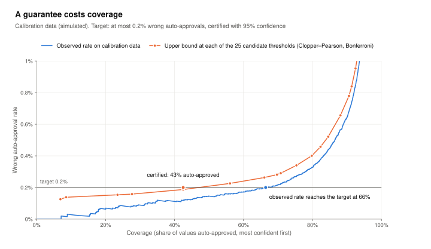
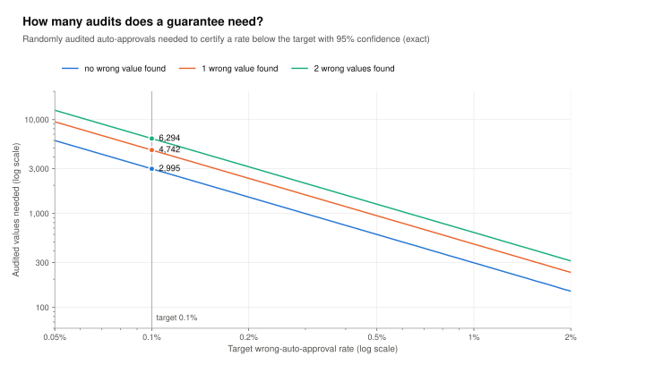

In my [previous post](/blog/reading-financial-documents-with-ai), I described three ways to build pipelines that read financial documents with AI.
The figure I care most about in that post is a stack of trust layers: a schema, grounding on the page, a blind cross-read by a second model, accounting rules, and, at the very bottom, a confidence threshold.
I gave that last layer a single line: *"necessary, never sufficient"*.
This post is about that line.

Think about the best junior credit analyst you have worked with.
It was probably not the one who never made mistakes.
It was the one who knocked on your door and said: "I'm not sure about this number. The scan is blurry, and it doesn't match last quarter."
That sentence is worth a lot.
It tells you exactly where to spend your attention.
An analyst who is right 98% of the time but never tells you which 2% are wrong forces you to re-check everything they hand in.

<figure class="jb_picture">
  {% responsive_image width: "100%" border: "0px solid #808080" path: img/posts/2026/2026-11-24/kungstradgarden-relic.jpg alt: "A carved stone face, part of an architectural relief, embedded in the raw rock wall of a Stockholm metro station" %}
  <figcaption class="stroke">
   &#169; This carved face is not decoration poured for the station. It is a relief salvaged from one of the historic buildings demolished during the redevelopment of central Stockholm in the 1950s and 1960s, and set into the unfinished cave rock of <a href="https://en.wikipedia.org/wiki/Kungstr%C3%A4dg%C3%A5rden_metro_station">Kungsträdgården metro station</a>. A fragment like this is only as trustworthy as your ability to trace it back to where it came from.
  </figcaption>
</figure>

<aside class="quote">
    <em>“A model that never says ‘I don’t know’ has to be checked every time it says anything.”</em>
</aside>

Large language models are not good at saying "I don't know."
Part of the reason is how they are trained and graded: most benchmarks give zero points for an honest abstention and some points for a lucky guess, so guessing wins.[^1]
Asking the model nicely to admit uncertainty helps a little, but it doesn't fix the incentive.
What does work is building a *confidence layer* around the model: a set of independent signals, a small scorer that combines them, a calibration step that turns the score into a real probability, and a threshold that comes with a statistical guarantee.
Plus the part most teams forget: a review process designed for the moments when the answer is "I don't know."

I'll keep the running example from the last post: covenant monitoring.
Every quarter, a corporate borrower sends a compliance pack.
The system extracts a dozen values from it (EBITDA, net debt, interest expense, and so on), code computes the ratios, and the ratios are tested against the covenants in the loan agreement.
Some of those values are covenant inputs, where an error can hide a breach.
Others feed analytics, where an error is annoying but cheap.

To make every claim in this post checkable, I built a simulation: 24,000 synthetic compliance packs with 12 values each (288,000 values in total), with realistic error types, and the signals a real pipeline would produce for each value.
All the code in this post is tested against it, and every chart marked as simulated comes from it.
The numbers are illustrative, not a benchmark.
The mechanics are exactly what I would run on real data.

In this post, I'll cover:

1. Why abstention is a feature, and how to measure a system that is allowed to say "I don't know."
2. How extraction fails *confidently*, and which signals catch which failures.
3. How to turn those signals into a calibrated probability, and how to choose a threshold you can make a promise about.
4. How to design the human side: review modes, canaries, and random audits.
5. How to keep the promise in production, and what supervisors will ask about it.

<figure class="jb_picture">
  
  <figcaption class="stroke">
    Figure 1. The confidence layer. Signals from the extraction are combined into a score, calibrated into a probability, and compared with a certified threshold for the value's tier. Everything else goes to people, with a reason. Reviews, audits, and canaries become labels that retrain, recalibrate, and recertify the layer. Each box is a section of this post.
  </figcaption>
</figure>

# Why “I Don’t Know” Is a Feature

Most document pipelines in banks start their life with 100% review.
The model pre-fills the values, and a person checks every one of them.
That is safe.
It is also where most projects stall, because the bank now pays for a model *and* for the same amount of checking as before.

Automation only pays off when you can skip checks.
And to skip a check, you need to know which values don't need one.
That is a different question from "how accurate is the model?", and it's the question this post is about.

## The Arithmetic of Many Fields

Start with a simple calculation.
Suppose the extractor gets each value right 99.5% of the time, which is excellent.
A full set of financial statements easily has 40 values that matter.
If errors are independent, the chance that *every* value in the pack is right is 0.995 to the power of 40, or about 82%.

<figure class="jb_picture">
  
  <figcaption class="stroke">
    Figure 2. The arithmetic of many fields. At 99.5% accuracy per value, roughly one 40-value pack in five contains at least one wrong number. You can't tell which pack, so a decision at the document level either reviews everything or trusts too much.
  </figcaption>
</figure>

So roughly one pack in five has at least one wrong number somewhere.
If the only choice is to trust or review a *whole document*, you are stuck: trusting the pack means letting that wrong number through, and reviewing it means checking 40 values to find one.
The decision has to happen at the level of individual values.
For each value, the system must answer one question: *can this go into the database without a person looking at it?*

## A Vocabulary for Abstention

A system that may decline to answer needs its own metrics.
Accuracy alone won't do, because accuracy doesn't care which answers you chose to trust.
These are the terms I'll use for the rest of the post:

- **Coverage.** The share of values the system auto-approves. The rest are routed to people. Coverage is your automation rate.
- **Wrong auto-approval rate (WAR).** The share of auto-approved values that are wrong. In the literature, this is called *selective risk*. In the last post, I called it the bank's real risk metric.
- **Abstention.** The system's "I don't know": a value is routed to review (or the document is sent back) instead of being trusted. In the literature, you'll also see *rejection* or *deferral*.
- **Straight-through processing (STP).** The share of *documents* that flow through with no human touch. It is always lower than coverage, for the reason in Figure 2.
- **Risk–coverage curve.** Sort all values from most to least confident. For every cut-off, plot coverage against WAR. This curve is the most useful single picture of a confidence layer.[^2] [^3]

The curve is easy to compute:


import numpy as np

def risk_coverage(confidence: np.ndarray, correct: np.ndarray):
    """Coverage and selective risk for every threshold, most confident first."""
    order = np.argsort(-confidence, kind="stable")
    wrong = 1 - correct[order]
    accepted = np.arange(1, len(order) + 1)
    return accepted / len(order), np.cumsum(wrong) / accepted

def aurc(confidence: np.ndarray, correct: np.ndarray) -> float:
    """Area under the risk-coverage curve: lower is better."""
    coverage, risk = risk_coverage(confidence, correct)
    return float(np.trapezoid(risk, coverage))

def coverage_at_risk(confidence: np.ndarray, correct: np.ndarray, target: float) -> float:
    """Largest coverage whose empirical selective risk stays at or below the target."""
    coverage, risk = risk_coverage(confidence, correct)
    ok = risk <= target
    return float(coverage[ok].max()) if ok.any() else 0.0


`risk_coverage` returns one point per possible threshold.
`aurc` integrates the curve into a single number (the area under the risk–coverage curve), which is a good way to compare scorers across all thresholds at once.[^4]
But a bank doesn't operate at all thresholds.
It operates at one.
So the number I look at first is `coverage_at_risk`: *at the risk I can accept, how much can I automate?*

## Ranking Beats Accuracy

Here is a result that surprises people.
Take two extractors.
Extractor A is right 98% of the time, but its confidence scores barely separate its right answers from its wrong ones.
Extractor B is right only 95% of the time, but its confidence scores separate right from wrong very well.
Which one should the bank use?

<figure class="jb_picture">
  
  <figcaption class="stroke">
    Figure 3. Accuracy is not the point; knowing which answers are wrong is. Extractor A is more accurate, but it can auto-approve only 14% of values at a 0.5% wrong auto-approval rate. Extractor B makes more mistakes, but it knows where they are, and it can auto-approve 86% at the same risk. Two hypothetical extractors with binormal confidence scores.
  </figcaption>
</figure>

Extractor B, by a mile.
At a target of 0.5% wrong auto-approvals, A can automate 14% of the values and B can automate 86%.
What separates them is *ranking*: the probability that a random correct value gets a higher score than a random wrong one.
That probability is the AUROC, which I covered for fraud models in [an earlier post](/blog/evaluation-metrics-for-real-time-financial-fraud-detection-ml-models).
For a confidence layer, it matters more than accuracy, because the whole job is to put the wrong values at the bottom of the list.

This is why "how accurate is your extractor?" is the wrong question to ask a vendor.
A better one is "what coverage do you get at 0.5% WAR on my documents?"
Answering it requires a confidence score worth ranking by, and that is exactly the part many products don't have.

## Chow’s Rule: Abstaining Has a Price, and So Does Guessing

The decision to abstain is an economic one, and it has a clean answer that is older than most of us.
In 1970, C. K. Chow derived the optimal rule for a recognition system that is allowed to refuse.[^5]
Translated to our setting: let $$c_r$$ be the cost of a human review and $$c_e$$ the cost of a wrong value that nobody catches.
If $$p$$ is the probability that the value is correct, trusting it costs $$(1 - p) \cdot c_e$$ on average, and reviewing it costs $$c_r$$.
So you should auto-approve when:

$$p > 1 - \frac{c_r}{c_e}$$

With a review that costs €4 and an undetected error that costs €1,000, the bar is 0.996: the value must be right at least 996 times out of 1,000 before it is cheaper to trust it than to look at it.
If an error costs €200, the bar drops to 0.98.
If it costs €5,000, it rises to 0.9992.

Notice what the rule assumes: that $$p$$ is a *real probability*.
If the system says 0.999 for values that are right 99% of the time, the rule silently approves values it was supposed to send to people.
That's why calibration, which I cover later, is not a nice-to-have.
It's what makes the threshold mean anything.

Pilots have a useful habit here.
On every approach, a go-around is a normal, trained, and blameless option.
Nobody gets in trouble for aborting a landing that didn't look right; people get in trouble for landing anyway.
An abstention should feel the same way inside your system: routine, cheap, logged, and never treated as a failure.
The failure is the confident wrong number that nobody looked at.

# A Short History of Knowing What You Don’t Know

None of the ideas in this post are new.
That is good news: it means they are well understood, and that a model validator can find textbooks about them.

<figure class="jb_picture">
  
  <figcaption class="stroke">
    Figure 4. Seventy years of teaching machines to abstain. Reject options, calibration, and distribution-free guarantees all predate LLMs by decades. What is new is applying them to a reader that can be confidently wrong in fluent language.
  </figcaption>
</figure>

The story starts with the weather.
In 1950, Glenn Brier proposed a score for probability forecasts: the average squared difference between the forecast probability and what actually happened.[^6]
A forecaster who says 90% and is wrong pays far more than one who said 60%.
Weather services have verified their forecasts this way for decades, and studies of US precipitation forecasts found that forecasters could state probabilities reliably: on days with a 70% forecast, it rained about 70% of the time.[^7]
Statisticians later formalized that property as *calibration*,[^8] and the reliability diagram I use later in this post comes from the same tradition of forecast verification.

The reject option itself was invented for the exact problem of this post.
In 1957, Chow described a character recognition system that refuses to classify a character when it isn't sure enough, and in 1970 he worked out the optimal trade-off between errors and rejections.[^9] [^5]
Machines reading printed text and declining to guess: that was the original use case.

Around 2000, machine learning learned to turn arbitrary classifier scores into probabilities.
Platt scaling fits a sigmoid to the scores; isotonic regression fits any monotone step function.[^10] [^11]
Both are still the workhorses of calibration in production.

Then came the guarantees.
Conformal prediction showed how to wrap any model with error guarantees that hold without assumptions about the model, as long as the future looks like the calibration data in a precise sense.[^12]
Selective classification formalized the trade-off between coverage and risk,[^2] and in 2017 Geifman and El-Yaniv showed how to pick a threshold for a deep network so that the risk of the accepted predictions stays below a target with high probability.[^3]
The certification code in this post follows that recipe.
In 2021, *Learn then Test* generalized it to almost any tunable parameter.[^13]

The same year as Geifman and El-Yaniv's paper, Guo and colleagues showed that modern neural networks are much more overconfident than older, smaller ones, and that a one-parameter fix (temperature scaling) recovers most of the calibration.[^14]
The pattern repeated with language models.
Large pretrained models turned out to be reasonably calibrated on multiple-choice questions when asked in the right format,[^15] but post-training for chat made calibration worse,[^16] and the confidence that models *state in words* tends to be overconfident.[^17]

The latest results pull in two directions.
Reasoning models express better-calibrated confidence than their non-reasoning counterparts (strictly better in 33 of 36 settings in one study),[^18] yet in a benchmark of 20 frontier models, reasoning fine-tuning made models *worse* at abstaining on unanswerable questions, by 24% on average.[^19]
And OpenAI researchers argued that hallucinations persist largely because training and evaluation reward guessing over admitting uncertainty.[^1]

Put together, the state of the art in one sentence is this: newer models describe their uncertainty better, but they are not more willing to act on it.
That's why I don't leave the decision to abstain to the model.
It belongs to a layer you own, test, and version.

# How Extraction Fails Confidently

Before choosing signals, it helps to be precise about how extraction goes wrong.
Almost every wrong value falls into one of four buckets.
What they have in common is that the model is usually *sure* of what it wrote.

<figure class="jb_picture">
  
  <figcaption class="stroke">
    Figure 5. Four ways to be confidently wrong. In each case, the model is sure about the characters it produced. The mistake is in where they came from or what they mean, which is exactly what token-level confidence cannot see.
  </figcaption>
</figure>

**1. Wrong cell.**
The number is printed on the page, and every digit is copied correctly, but it came from the wrong place: last year's column, the parent company instead of the group, the quarter instead of the year to date.
This is the most common error on clean digital documents, and the most dangerous one for naive grounding, because "is this number on the page?" returns yes.
What catches it is a check of the *layout*: the column header above the value, the row label next to it, and a rule that flags a current value equal to the prior one.

**2. Misread.**
A blurry 3 becomes an 8; a 1 loses its serif and becomes a 7.
This dominates on scanned pages.
Here, the model's internals sometimes help: the probability of the token that spells the uncertain digit is often lower than the rest.
But the overall answer still reads fluently, so a confidence number for the whole answer stays high.
A second reader, OCR-based grounding, and arithmetic (net debt = gross debt − cash) catch most of these.

**3. Sign or scale.**
The model copies `(486)` as `486`, or misses the "EUR thousands" line at the top of the table and stores 486 instead of 486,000.
The digits are right, so every token-level signal says "very sure."
The meaning is wrong.
The fix from the last post still applies: let the model read values *as printed* and let code apply sign and scale.
Rules and history catch what slips through: EBITDA must equal operating profit plus depreciation and amortization, and a value that jumps by a factor of 1,000 from last quarter is not a business event.

**4. Not printed.**
The pack doesn't contain the value (capital expenditure lives in a note that wasn't included), and the model produces a plausible number anyway.
This is the classic hallucination, and it is the most dangerous case because there is nothing on the page to point at.
It is also the easiest to catch *if* you look: grounding finds no match anywhere, a blind cross-read returns null or a different number, and a schema that explicitly allows "not found" gives the model a way out.

In the simulation, I mirrored this mix.
About 35% of wrong values come from the wrong cell, 32% are misreads, 19% are sign or scale errors, and 15% are not printed at all.
Scanned packs (a quarter of the total) have an error rate of about 15%, against 3% for digital ones.

## Is It the Page or the Reader?

The four buckets hide a distinction that matters for what you do next.
Some doubt comes from the **page**: the scan is blurry, the table is cut off, the pack is incomplete.
Statisticians call this *aleatoric* uncertainty.
No amount of modeling will remove it.
The right response is often to reject the document and ask for a better copy.

Other doubt comes from the **reader**: the template has never been seen, the layout is unusual, the language is unfamiliar.
This is *epistemic* uncertainty, and it shrinks with data.
The right response is to route the value to review and make sure the reviewed result ends up in the training and calibration data.

A good confidence layer keeps the two apart.
A low score caused by a terrible scan and a low score caused by a new template should not end up in the same queue with the same reason, because the fixes are different.

## Why the Model’s Own Confidence Misses These

There is a simple reason why the model's self-assessment fails on exactly these errors.
Token-level confidence measures how sure the model is about *the characters it wrote*, given what it saw.
Extraction errors are mostly about *where it looked* and *what the characters mean*.
A model can be perfectly certain that it is copying "486", and perfectly wrong that "486" is this year's EBITDA in euros.

<aside class="quote">
    <em>“Fluency is not accuracy. The model is most confident when it copies the wrong number perfectly.”</em>
</aside>

This doesn't mean the model's confidence is useless.
It means it is *one* signal among several, and a weak one for the errors that matter most.
The confidence layer is built from signals that look at the value from different angles.

# Let the Model Say It First

The confidence layer doesn't replace asking the model to abstain.
It complements it.
A few changes to the extraction call make "I don't know" cheap for the model to say, and they turn its abstentions into signals that code can act on.

**Give it a way out in the schema.**
If the output schema demands a number for every field, the model will produce a number for every field.
Structured outputs are very good at enforcing shapes, including the shape that leaves no room for doubt.
So make every value optional, and add a status with a small, fixed set of reasons:


from enum import Enum

from pydantic import BaseModel, model_validator

class Status(str, Enum):
    FOUND = "found"
    NOT_FOUND = "not_found"   # the pack does not contain this value
    ILLEGIBLE = "illegible"   # printed, but cannot be read reliably
    AMBIGUOUS = "ambiguous"   # more than one plausible candidate (e.g., restated)

class Reading(BaseModel):
    metric: str                               # from a fixed dictionary
    status: Status
    value_as_printed: str | None = None       # "(486)": sign and scale are applied in code
    page: int | None = None
    candidates: list[str] = []                # filled only when status is AMBIGUOUS

    @model_validator(mode="after")
    def evidence_matches_status(self):
        if (self.status == Status.FOUND) != (self.value_as_printed is not None):
            raise ValueError("a value is required if and only if the status is 'found'")
        if self.status == Status.FOUND and self.page is None:
            raise ValueError("a found value needs a page")
        return self


The validator enforces the obvious invariants: a value exists if and only if the status is `found`, and a found value must say which page it came from.
Each status leads somewhere different.
`not_found` triggers a completeness check on the pack (is a page missing, or does this borrower not report capital expenditure?).
`illegible` is a page problem, so the document is a candidate for rejection.
`ambiguous` goes to review with all the candidates on screen, which is exactly what a reviewer needs when a pack contains both the original and the restated figure.

**Say that abstaining is acceptable, and that guessing costs more.**
State it in the instructions: a missing value is better than a guessed one.
Kalai and colleagues propose that evaluations state an explicit confidence target in their instructions: a wrong answer costs points, "I don't know" costs nothing, so guessing only pays above the stated confidence.[^1]
The same wording works in an extraction prompt.
Prompting helps, but it isn't a cure.
The AbstentionBench study found that a carefully written system prompt improves abstention in practice without fixing the underlying weakness.[^19]

**Ask for evidence, so absence becomes visible.**
In the last post, every value came with a page and a quote or a box.
That requirement does double duty here: a value without evidence is something code can detect, and an invented value usually comes with evidence that doesn't check out.
A hallucination is hard to catch when there is nothing to verify.
Requiring evidence creates something to verify.

**Believe abstentions; don't trust their absence.**
Treat the model's abstentions asymmetrically.
When it says a value is illegible or not found, take it at its word: that value should not be auto-approved, whatever the other signals say.
When it *doesn't* abstain, that tells you much less, for all the reasons in the previous section.
In the routing policy, an abstention is a hard stop; in the scorer, the lack of one is just another weak feature.

**Put unanswerable cases in your gold set.**
This one is easy to miss.
If every field in your evaluation set exists and is legible, then every prompt change that makes the model abstain *less* will look like an improvement, because it gets a few more values right and is never penalized for guessing.
That's the benchmark problem Kalai and colleagues describe, reproduced inside your own team.
Include packs where values are genuinely missing, pages that are illegible, and tables with a restated column, and score a correct "not found" as a correct answer.

# Where Confidence Comes From

A confidence layer is only as good as the evidence it combines.
The useful mental model is a panel of imperfect witnesses: each one sees part of the scene, each one has blind spots, and the blind spots are in different places.
Figure 6 is the map I use.

<figure class="jb_picture">
  
  <figcaption class="stroke">
    Figure 6. Which signal catches which error. No row is strong everywhere, and the strong cells are spread across different rows. That is the whole argument for combining signals instead of picking the best one.
  </figcaption>
</figure>

## The Model’s Own View

**Self-reported confidence.**
You can ask the model for a confidence between 0 and 1 next to every value, and in the last post I did.
It is free, and it is better than nothing.
But studies of verbalized confidence find that the numbers models state in words tend to be overconfident,[^17] and in practice they cluster at a few round values (0.9, 0.95, 1.0).
Post-trained models are an interesting exception: their stated confidence can be better calibrated than their token probabilities,[^20] and reasoning models do better still.[^18]
I treat it as a weak feature and never as a decision.

**Token log-probabilities.**
Some APIs return the log-probability of every generated token.
For extraction, the interesting tokens are the ones that spell the value, not the JSON around it, and the most informative statistic is the *minimum*: one uncertain digit is enough to make the whole number wrong.
The function below finds the value inside the generated tokens and summarizes its log-probabilities:


def value_logprob_features(tokens: list[str], logprobs: list[float] | None,
                           value_text: str) -> dict[str, float | None]:
    """Log-prob features of the tokens that spell the extracted value."""
    text, starts = "", []
    for tok in tokens:
        starts.append(len(text))
        text += tok
    i = text.find(value_text)
    if not logprobs or i < 0:
        return {"min_logprob": None, "mean_logprob": None}  # missing is a signal too
    end = i + len(value_text)
    span = [lp for s, tok, lp in zip(starts, tokens, logprobs) if s < end and s + len(tok) > i]
    return {"min_logprob": min(span), "mean_logprob": sum(span) / len(span)}


Two details matter.
First, a value spread over several tokens (`(`, `48`, `6`, `)`) must be matched by character offsets, not token by token.
Second, when log-probabilities are not available, the function returns `None`, not zero.
A missing signal is information, and it must never be confused with a confident one.
This happens more than you'd think: OpenAI's API, for example, rejects log-probability requests for its reasoning models.[^21]
So the scorer must work with and without this feature, and the decision to auto-approve must not quietly depend on it.

**Self-consistency.**
Ask the same question several times with sampling and measure agreement.
For open-ended answers this is a powerful idea,[^22] and its refined version (clustering answers by meaning, "semantic entropy") is one of the better hallucination detectors in the literature.[^23]
For number extraction, I find it disappointing for the cost.
If the model misreads a blurry digit, it tends to misread it the same way five times.
Agreement among samples of one model measures stability, not correctness.

## A Second Reader

**Blind cross-read.**
A *different* model reads the same row and column without seeing the first answer, and code compares the two values.
In the simulation, it is the strongest single signal, and it is especially good against misreads and invented values.
Its weakness is that models share blind spots.
A large study of more than 350 LLMs found that when two models are both wrong, they often give the *same* wrong answer (60% of the time on one leaderboard dataset), and that more accurate models have *more* correlated errors, even across providers.[^24]
Agreement between two strong models is good evidence, but it is not independence.
A wrong-cell error, where both models are drawn to the same misleading column, is precisely the case where they tend to agree.

## Evidence on the Page

**Layout and grounding.**
This is the code from archetype C in the last post: is the value printed inside the box the model pointed to, is its row label next to it, and is the column header the right period?
Grounding (printed in the box) is strong against misreads and invented values.
The layout check (right row, right column) is what catches wrong-cell errors, the one failure that grounding alone waves through.
Both are deterministic, cheap, and easy to explain to an auditor.

## The Rules of Accounting

Financial statements are full of identities, and identities are free error detectors.
Assets equal liabilities plus equity.
Subtotals equal the sum of their lines.
Net debt equals gross debt minus cash.
EBITDA equals operating profit plus depreciation and amortization.
Signs follow conventions: interest expense is a cost, and revenue is not negative.
A value that breaks an identity is not necessarily wrong (the *other* value in the identity may be the wrong one), but the pair deserves a look.
The limitation is coverage: in the simulation, 8 of the 12 fields take part in at least one rule, and the other 4 get no help from this signal at all.

## History and Context

**The borrower's own history.**
Compare each value with the same borrower's previous quarters, as a z-score or a ratio.
A thousand-fold jump is almost always a scale error.
But a legitimate business event (an acquisition, a write-down) also looks like an outlier, so history is a reason to review, never proof of an error.
New borrowers have no history, which is, again, a missing signal and not a reassuring one.

**Document context.**
Whether the page is scanned, the image quality, and whether the template has been seen before don't point at a specific value.
They shift the *base rate*: on a blurry scan of an unfamiliar template, every value is more likely to be wrong.
The scorer should know that.

**Process signals.**
How the answer was produced is evidence too.
A value that needed two retries, a JSON repair, or a fallback model is not the same as one that came back cleanly on the first call.
Log every one of these events and feed the useful ones to the scorer.
They also make great monitoring metrics later.

## What Combining Buys You

Here is what the simulation says when you use each signal alone, compared with all of them combined by the scorer of the next section.
The coverage column is the share of values you could auto-approve while keeping the observed wrong auto-approval rate at or below 0.5% on the test set.

| Signal (simulated, test set)                        | AUROC | Coverage at 0.5% WAR |
|-----------------------------------------------------|------:|---------------------:|
| Self-reported confidence                            |  0.77 |                 0.2% |
| Lowest token log-probability of the value           |  0.62 |                 0.6% |
| Grounding tier                                      |  0.79 |                 0.1% |
| Blind cross-read agrees                             |  0.82 |                 0.0% |
| All signals, learned scorer with calibration        |  0.98 |                  88% |

No single signal can isolate a group of values clean enough to meet a 0.5% target.
Even when the cross-read agrees, a few percent of those values are still wrong (mostly wrong-cell errors where both readers fell into the same trap), and you can't separate them further with that signal alone.
The log-probability looks weak overall, but that is partly because it is missing for 40% of the simulated documents: where the model exposes it, its AUROC is 0.85.
Combined, the signals cover each other's blind spots, and the share of values you can automate jumps from almost nothing to 88%.

That is the main lesson of this section.
Don't look for the best signal.
Look for signals that fail in *different* places.

# From Signals to a Probability

Combining signals sounds like a job for hand-written rules: "auto-approve if grounded and the cross-read agrees and no rule fails."
That works on day one, and I'd start there.
It breaks down quickly, though, because the rules multiply, they interact, and nobody can say what probability of being right a given combination corresponds to.
The cleaner design is a small learned model that turns the signals into one number, followed by a calibration step that makes the number mean something.

<figure class="jb_picture">
  
  <figcaption class="stroke">
    Figure 7. Inside the confidence engine. Everything that decides is learned offline on labeled data, released as one versioned bundle, and applied online without changes. Fit, calibration, certification, and testing each use their own data.
  </figcaption>
</figure>

## The Scorer

I use gradient-boosted trees for the scorer.
They handle missing values natively, they capture interactions (a failed rule matters more on a scanned page), they train in seconds, and they can be constrained to behave in ways a validator can check.
Here is the whole thing:


import pandas as pd
from sklearn.ensemble import HistGradientBoostingClassifier
from sklearn.model_selection import GroupShuffleSplit

FEATURES = {  # feature -> monotone direction with respect to P(correct)
    "grounding": +1,           # NONE=0 < FUZZY=1 < NUMERIC=2 < EXACT=3
    "cross_read_agrees": +1,   # a different model, reading blind
    "rules_failed": -1,        # accounting identities, sums, sign conventions
    "min_logprob": +1,         # NaN when the model does not expose log-probs
    "history_absz": -1,        # NaN for borrowers without history
    "verbal_conf": 0,          # the model's own number: a weak feature, nothing more
    "doc_quality": +1,
    "scanned": -1,
    "template_seen": +1,
    "tier": 0,
}

def split_by_borrower(df: pd.DataFrame, seed: int = 0):
    """Train / calibration / test, with every borrower in exactly one split."""
    gss = GroupShuffleSplit(n_splits=1, test_size=0.5, random_state=seed)
    train_idx, rest_idx = next(gss.split(df, groups=df["borrower"]))
    rest = df.iloc[rest_idx]
    cal_idx, test_idx = next(gss.split(rest, groups=rest["borrower"]))
    return df.iloc[train_idx], rest.iloc[cal_idx], rest.iloc[test_idx]

def train_scorer(train: pd.DataFrame) -> HistGradientBoostingClassifier:
    scorer = HistGradientBoostingClassifier(
        learning_rate=0.05, max_iter=500, max_leaf_nodes=31, l2_regularization=1.0,
        monotonic_cst=list(FEATURES.values()), early_stopping=True, random_state=0,
    )
    return scorer.fit(train[list(FEATURES)], train["correct"])


Three design choices deserve a comment.

**Monotone constraints.**
The `FEATURES` dictionary declares, for every signal, the direction in which it is allowed to move the score.[^25]
A better grounding tier can never *lower* the probability of being right, and a failed rule can never raise it.
Without constraints, a flexible model will happily learn spurious patterns from a few thousand labels, like "values with exact grounding *and* a failed rule are fine," because that happened to be true in the training data.
With constraints, the scorer's behavior matches what a domain expert would expect, and you can explain each signal's role in one sentence.
The model's self-reported confidence gets a `0`: it can be used, but the scorer is not forced to trust it.

**Grouped splits.**
A borrower's packs share a template, a layout, an accountant, and often the same mistakes.
If one quarter of a borrower is in training and the next quarter is in test, the test score measures memory, not generalization.
`split_by_borrower` keeps every borrower in exactly one split.[^26]
In the simulation, that means about 5,900 borrowers with four packs each, divided into training (50%), calibration (25%), and test (25%).
In a real portfolio, I'd also split by *time*: train on older quarters, calibrate and test on newer ones, because that is how the system will be used.

**Missing stays missing.**
Log-probabilities and history arrive as `NaN` when they don't exist.
The trees learn what "missing" means from data, which is much safer than filling with zeros (a "perfect" log-probability) or with averages.

## What Calibration Means

The scorer outputs a number between 0 and 1.
It is not yet a probability you can put into Chow's rule.
A **calibrated** score is one where the number means what it says: among all values with a score of 0.99, about 99% are right; among all values with a score of 0.9, about 90% are right.
It's the weather forecaster's property from the history section, applied to numbers in a PDF.

The way to check it is a **reliability diagram**: bin the held-out values by predicted probability, and plot the observed share of correct values in each bin against the average prediction.
A calibrated score sits on the diagonal.

<figure class="jb_picture">
  
  <figcaption class="stroke">
    Figure 8. Self-reported confidence vs. a calibrated scorer (simulated). When the model says 90%, it is right 74% of the time. The calibrated scorer can be read as a probability. The bins narrow near 100% on purpose: that is where thresholds live.
  </figcaption>
</figure>

In the simulation, the model's self-reported confidence says "1.0" for 61% of all values, and those values are right 98% of the time.
That sounds fine until you put it into Chow's rule: a "certain" value that is wrong one time in fifty is far below the bar of 0.996 from the earlier example.
The calibrated scorer, on the other hand, stays on the diagonal all the way into the tail.
The usual summary statistic, the expected calibration error (ECE), is 0.032 for the self-reported confidence and 0.0011 for the calibrated scorer.

There are three standard ways to calibrate a score:

- **Platt scaling** fits a sigmoid with two parameters. It is robust with little data, but it can only fix distortions that look like a sigmoid.
- **Isotonic regression** fits any non-decreasing step function. It is more flexible but overfits small samples; scikit-learn's guide recommends it once there are more than about a thousand calibration examples.[^10] [^27]
- **Temperature scaling** divides a neural network's logits by one learned constant.[^14] It is the right tool when you calibrate a network's own outputs, not a separate scorer like mine.

With tens of thousands of labeled values per release, I use isotonic regression, fitted on the calibration split, separately for each segment that behaves differently:


import numpy as np
import pandas as pd
from sklearn.isotonic import IsotonicRegression

class SegmentCalibrator:
    """One isotonic map per segment (e.g. scanned vs. digital), fitted on held-out data."""

    def __init__(self, segment: str):
        self.segment, self.maps = segment, {}

    def fit(self, frame: pd.DataFrame, raw: np.ndarray, correct: np.ndarray):
        for seg in frame[self.segment].unique():
            m = (frame[self.segment] == seg).to_numpy()
            iso = IsotonicRegression(y_min=0.0, y_max=1.0, out_of_bounds="clip")
            self.maps[seg] = iso.fit(raw[m], correct[m])
        return self

    def predict(self, frame: pd.DataFrame, raw: np.ndarray) -> np.ndarray:
        p = np.zeros_like(raw)  # unseen segment -> 0 -> routed to review (fail closed)
        for seg, iso in self.maps.items():
            m = (frame[self.segment] == seg).to_numpy()
            p[m] = iso.predict(raw[m])
        return p

def expected_calibration_error(p: np.ndarray, correct: np.ndarray, bins: int = 10) -> float:
    """Weighted mean |accuracy - confidence| over equal-mass bins."""
    chunks = np.array_split(np.argsort(p), bins)
    return float(sum(len(c) / len(p) * abs(correct[c].mean() - p[c].mean()) for c in chunks))


Why per segment?
Because a scanned page and a digital page with the same raw score are not equally likely to be right, and a single calibration curve averages them into something true for neither.
In the simulation, I calibrate digital and scanned values separately.
In a real system, I'd consider segments for document type, language, and template family, each with enough labeled values to fit a curve.

Note the first line of `predict`: a segment that was never seen during calibration gets a probability of zero.
That's not pessimism; it's the system saying "I have no evidence about this kind of document," which routes every value from it to review.
This is the confidence layer failing closed.

A word of honesty about the scorer itself.
Gradient boosting trained with log-loss is often close to calibrated on data that looks like its training data, and in the simulation the raw scorer was already good (ECE 0.0015 before calibration).
The calibration step earns its keep elsewhere: it is fitted on data the scorer never saw, it can be refitted without retraining the scorer, and it adapts to each segment.

## Calibration in the Tail

ECE has a blind spot that matters here.
It is an average over all values, and most values are easy.
A scorer can have a tiny ECE and still be off exactly where you care: above 0.99, where the thresholds sit.
Being off by half a percentage point at 0.5 is irrelevant; being off by half a percentage point at 0.996 doubles your error rate.

So I always look at the reliability diagram with narrow bins near 1, as in Figure 8, and I check the number of values in each of those bins.
If the top bins have a few hundred values, the calibration there is a guess.
That observation leads directly to the next question: if the probability itself is estimated from limited data, how do you choose a threshold you can stand behind?

# Choosing the Threshold

With a calibrated probability for every value, one decision is left: where to draw the line.
There are two ways to think about it, and a bank needs both.
The first is economic: which threshold minimizes the total cost?
The second is about risk: which threshold lets you make a promise about the error rate, and keep it?

## Option 1: Price It

Chow's rule from earlier gives the threshold directly from two costs.
Figure 9 shows what it means for the whole portfolio of simulated values: the expected cost of every possible policy, relative to reviewing everything.

<figure class="jb_picture">
  
  <figcaption class="stroke">
    Figure 9. The cheapest threshold depends on what an error costs (simulated). With a €4 review, automation cuts total cost to 31% if an undetected error costs €200, but only to 91% if it costs €5,000. Past the minimum, every curve climbs fast: automating too much is more expensive than not automating at all.
  </figcaption>
</figure>

Three things stand out.
First, the optimal coverage moves a lot with the cost of an error: from 82% of values at €200 per error, to 64% at €1,000, to 23% at €5,000.
Second, the curves are flat near their minimum and very steep after it, so erring on the side of *less* automation is cheap, and erring on the side of more is expensive.
Third, at high error costs, the whole exercise saves little; a confidence layer is not magic, and for some fields the honest answer is "review them all."

In practice, the cost of an error is not one number.
A wrong EBITDA in a covenant test can hide a breach and delay a conversation the bank needed to have; a wrong headcount in an analytics table costs almost nothing.
That's why I group fields into **tiers** by the cost of an undetected error and give each tier its own threshold.
In the simulation, tier 1 holds the four covenant inputs, tier 2 four values used in credit memos, and tier 3 four values used for analytics.
Ask the business for the cost of an error per tier.
A range is fine; the shape of Figure 9 makes the answer robust to rough estimates.

## Option 2: Promise It

A risk officer will rarely ask what the threshold costs.
They will ask what you can *promise*.
And "the scorer says 0.996" is not a promise; it's an estimate from finite data.
The promise I want to be able to make sounds like this:

> With 95% confidence, at most 0.3% of the tier-1 values we auto-approve are wrong.

That sentence has two numbers: the target error rate (0.3%) and the confidence that we meet it (95%).
To back it up, you need an **upper bound** on the error rate among the values a threshold accepts, not just the observed rate.
The classic tool is the Clopper–Pearson bound for a binomial proportion:[^28] if you accepted $$n$$ values and found $$k$$ errors, the true error rate is below the bound with the confidence you chose.

A useful special case is the *rule of three*: if you observe zero errors in $$n$$ values, the 95% upper bound is about $$3/n$$.[^29]
Zero errors in 3,000 values supports a claim of "below 0.1%."
Zero errors in 300 supports only "below 1%," however clean the sample looked.

The certification code checks a fixed grid of candidate thresholds, from strict to lenient, and keeps the most lenient one whose upper bound still meets the target:


import numpy as np
from scipy.stats import beta

def upper_bound(errors: int, n: int, delta: float = 0.05) -> float:
    """One-sided Clopper-Pearson upper bound on an error rate."""
    if n == 0 or errors >= n:
        return 1.0
    return float(beta.ppf(1 - delta, errors + 1, n - errors))

GRID = 1 - np.geomspace(1e-4, 0.2, 25)  # candidate thresholds, fixed before looking at data

def certify_threshold(p_cal: np.ndarray, correct_cal: np.ndarray, alpha: float,
                      delta: float = 0.05, grid: np.ndarray = GRID) -> dict | None:
    """Most permissive threshold whose wrong-auto-approval rate is <= alpha with
    probability >= 1 - delta. Each candidate is tested at delta / len(grid)."""
    level, best = delta / len(grid), None
    for t in np.sort(grid)[::-1]:                     # strict -> lenient
        accepted = p_cal >= t
        n, errors = int(accepted.sum()), int((correct_cal[accepted] == 0).sum())
        if n and upper_bound(errors, n, level) <= alpha:
            best = {"threshold": float(t), "coverage": n / len(p_cal), "errors": errors, "n": n}
    return best  # None: nothing can be certified, so nothing is automated


Two details make this correct rather than merely plausible.

**The grid is fixed before looking at the data.**
If you scan every possible threshold and pick the best-looking one, you are testing hundreds of hypotheses and reporting the luckiest, and the 95% stops being 95%.
`certify_threshold` tests 25 candidates fixed in advance and splits the error budget among them (each test runs at 0.05/25, a Bonferroni correction), so the 95% holds simultaneously for all of them.
This is the recipe of *selection with guaranteed risk*,[^3] and an instance of the more general *Learn then Test* framework, which also offers sharper procedures than Bonferroni.[^13]
I start with Bonferroni because it is the version I can explain to a validator on a whiteboard.

**Certification uses its own data.**
The thresholds are certified on the calibration split, and the numbers I report come from the test split, which nothing else has touched.
Reusing the scorer's training data for certification would make every bound optimistic.

Figure 10 shows what the promise costs.

<figure class="jb_picture">
  
  <figcaption class="stroke">
    Figure 10. A guarantee costs coverage (simulated). Picking the threshold where the observed rate hits the 0.2% target would automate 66% of the values. Requiring the upper bound to stay below the target automates 43%. The gap is the price of a promise you can defend.
  </figcaption>
</figure>

With a single global target of 0.2%, the observed error rate on the calibration data stays under the target up to 66% coverage.
A naive threshold placed there would only be right on average: on the next batch of documents, the real rate would land above 0.2% about half the time, and probably more often, because the best-looking point on a noisy curve is an optimistic one.
The certified threshold automates 43%: 30,398 accepted values with 36 errors (0.12%), whose upper bound is just under 0.2%.
The 23 points of coverage between the two are not waste.
They are the margin that turns an estimate into a commitment.

With one threshold per tier, the simulated system looks like this on the untouched test split:

| Tier (simulated)        | Target WAR | Certified threshold | Coverage on test | Observed WAR on test |
|-------------------------|-----------:|--------------------:|-----------------:|---------------------:|
| 1: covenant inputs      |       0.3% |              0.9955 |              70% |                0.13% |
| 2: credit memo values   |       0.5% |              0.9841 |              81% |                0.30% |
| 3: analytics values     |       1.0% |              0.9437 |              91% |                0.83% |

Overall, 81% of the values are auto-approved, and every tier stays below its target, with room to spare in tiers 1 and 2.
That room is not an accident: the bound is conservative by design, and the guarantee is only worth something if it holds on bad days too.

## Where Conformal Prediction Fits

If you have read about conformal prediction, you may recognize the structure: hold out calibration data, compute a statistic on it, and set a threshold so that a guarantee holds for new data.[^30]
The family has grown well beyond prediction sets.
*Conformal risk control* bounds the expected value of any monotone loss, such as the error rate among accepted values.[^31]
For language models, *conformal abstention* uses the same idea to decide when an LLM should answer or say "I don't know," with a bound on the hallucination rate,[^32] and *conformal factuality* removes claims from a generated text until the remainder is correct with high probability.[^33]

All of these rest on the same assumption: **exchangeability**.
Roughly, the new documents must look like the calibration documents, in the statistical sense of being drawn from the same process.
That is the fine print of every guarantee in this post.
A new template, a new model version, or a wave of documents from a new market breaks it.
I'll come back to that in the section on production.

## Averages Hide Segments

There is a second piece of fine print, and it's easy to miss.
The guarantee is about the *average* over everything in a tier.
In the simulation, tier 3 met its 1% target overall (0.83%).
But inside tier 3, the auto-approved values from scanned documents were wrong 1.9% of the time, almost double the target, while digital ones were at 0.55%.
Nothing was broken.
The math promised an average, and it delivered an average.

If scanned documents matter on their own (and in a bank, a segment often has its own owner, process, or regulatory angle), you must certify them on their own, with one threshold per tier *and* segment.
In the simulation, that has a sobering effect: with about 6,000 calibration values per tier for scans, no threshold can be certified for scanned documents at all.
The observed error rates are fine, but there isn't enough data to prove it at 95% confidence.
Value-level automation drops from 81% to 67%, and every scanned value goes to people.

I like this result.
It is the confidence layer saying "I don't know" about an entire segment, and it is the right answer until you have labeled enough scans.
It also turns a vague debate ("are we ready to automate scans?") into a concrete plan: how many labeled scanned values do we need for a certificate, and how long will it take to collect them?

# The “I Don’t Know” Path

A threshold is just a number until something acts on it.
The routing function is where the confidence layer meets the rest of the pipeline, and it is the part I'd want a validator to read first.
It should be short, boring, and impossible to misread:


from dataclasses import dataclass

@dataclass(frozen=True)
class Policy:
    thresholds: dict[int, float]                     # per tier, certified on calibration data
    required: tuple[str, ...] = ("grounding", "cross_read_agrees", "rules_failed")

def route(value: dict, p_correct: float | None, policy: Policy) -> tuple[str, str]:
    """Return (decision, reason). Anything unusual goes to a person."""
    missing = [s for s in policy.required if value.get(s) is None]
    if missing:
        return "review", f"missing signal: {', '.join(missing)}"
    if p_correct is None or not 0.0 <= p_correct <= 1.0:
        return "review", "no valid confidence score"
    threshold = policy.thresholds.get(value["tier"])
    if threshold is None:
        return "review", f"no certified threshold for tier {value['tier']}"
    if p_correct < threshold:
        return "review", f"p={p_correct:.4f} below tier-{value['tier']} threshold {threshold:.4f}"
    return "auto_approve", "passed all checks"

def route_document(decisions: list[tuple[str, str]], tiers: list[int]) -> str:
    """A document flows straight through only if every tier-1 value was auto-approved."""
    tier1 = [d for (d, _), t in zip(decisions, tiers) if t == 1]
    return "straight_through" if all(d == "auto_approve" for d in tier1) else "needs_review"


The design choices are the same ones I argued for in the last post, now applied to confidence.

**Every decision comes with a reason.**
The function never returns a bare "no."
It returns *why*: a missing signal, an invalid score, no certified threshold for the tier, or a probability below the bar (with both numbers).
The reason travels with the value into the review queue, into the audit log, and into the monitoring dashboards.
"Why is this value here?" is the first question every reviewer asks, and the answer should be on the screen.

**Anything unusual fails closed.**
If a required signal is missing (the cross-read timed out, the grounding step crashed), the value goes to review, whatever its score.
If the score is outside 0 to 1, it goes to review.
If a tier has no certified threshold, because the certification found nothing it could promise, every value in that tier goes to review.
In the simulation, a tier-1 value with a probability of 0.999 but no cross-read result is routed with the reason `missing signal: cross_read_agrees`.
The scorer may know how to handle missing features, but the *policy* shouldn't auto-approve on evidence it was told to require.

**The policy is a frozen, versioned object.**
`Policy` is immutable, and in production it is loaded from the same bundle as the scorer and the calibrator.
A threshold without the scorer it was certified for is meaningless, and the code shouldn't make it possible to mix them.

**Documents are routed after values.**
`route_document` lets a pack flow straight through only if *every* tier-1 value was auto-approved.
This is where Figure 2 comes back: in the simulation, 81% of values are auto-approved, but only 43% of packs pass straight through, because each pack has four tier-1 values and all four must clear the strictest threshold.
When someone asks why automation "only" reaches 43%, that is the answer, and the lever is the tier-1 threshold, not the average.

## One Pack, End to End

To make this concrete, here is one pack from the simulated test set, followed through the layer.
It is a clean digital document from a known template, the kind you would expect to sail through.
I gave the twelve simulated fields realistic names.

| Value                  | Tier | What the signals said                                                                                             |     p | Decision                    | Truth                          |
|------------------------|:----:|-------------------------------------------------------------------------------------------------------------------|------:|-----------------------------|--------------------------------|
| EBITDA                 |  1   | Grounded exactly, rules pass, but the blind cross-read **disagrees**                                              | 0.966 | Review: below 0.9955        | Correct; the second reader erred |
| Net debt               |  1   | Every signal agrees                                                                                               | 0.998 | Auto-approve                | Correct                        |
| Interest expense       |  1   | Every signal agrees                                                                                               | 0.999 | Auto-approve                | Correct                        |
| Total equity           |  1   | Every signal agrees                                                                                               | 0.997 | Auto-approve                | Correct                        |
| Operating cash flow    |  2   | Only a numeric match on the page, cross-read disagrees, a rule fails, 4.4 standard deviations from history; self-reported confidence 0.95 | 0.000 | Review: below 0.9841        | Wrong: sign dropped            |
| Dividends paid         |  3   | Numeric match on the page, cross-read agrees, no rule covers it; self-reported confidence 1.0                     | 0.966 | Auto-approve: above 0.9437  | Wrong: last year's column      |
| Six other values       | 2–3  | Every signal agrees                                                                                               |  ≥0.996 | Auto-approve              | Correct                        |

Three things happen in this one pack, and together they summarize the post.

The operating cash flow error is caught easily.
The model was 95% sure of itself, but three independent signals disagreed with it, and the scorer gave it essentially no chance of being right.
That is the confidence layer working as intended.

EBITDA goes to review even though it is correct, because the second reader got it wrong.
That's the price of caution: a reviewer will re-key it blind, the two readings will match, and the value goes through with a label that says the cross-reader erred, which is useful training data.
And because EBITDA is a tier-1 value, the whole pack waits for that review instead of flowing straight through.

The dividends value is the interesting one.
It has *the same* calibrated probability as EBITDA, 0.966, and gets the opposite decision, because it sits in tier 3, where an error is cheap and the threshold is lower.
And it is wrong: a wrong-cell error where both readers took last year's figure, and no accounting rule covers the field.
This is not a bug.
It is what a 1% error budget looks like from the inside: about one auto-approved tier-3 value in a hundred will be wrong, and this is one of them.
If that is not acceptable for dividends, the answer is to move the field to a stricter tier, or to add a layout check that confirms the column header, not to hope the next pack is luckier.

## Three Outcomes, Not Two

It is tempting to think of abstention as a binary: approve or review.
In practice, I need three outcomes.

1. **Auto-approve.** The value is stored with its full lineage: page, box, both readings, the probability, and the policy version.
2. **Review.** A person decides, with the evidence and the reason on screen.
3. **Reject.** The *document* is unusable (illegible, incomplete, the wrong period), and the right action is to ask the borrower for a better copy.

The third outcome matters because of the distinction between page problems and reader problems.
Sending a blurry scan to a reviewer just moves the guessing from a model to a person.
A reviewer facing an illegible number, with no easy way to escalate, is likely to type a best guess.
So make rejection a first-class button.

## The Queue Is a Product

Once abstention is routine, the review queue becomes a production system with its own design questions.

**Priority.**
Not all doubtful values are equally urgent.
I sort by materiality times doubt: a covenant input with a probability of 0.9 comes before an analytics value with 0.5, and anything blocking a covenant test comes first.

**Capacity.**
Queues obey Little's law: the average number of items waiting equals the arrival rate times the average time each one waits.[^34]
Suppose (illustratively) the bank receives 400 packs a day with 12 values each.
At 81% coverage, about 900 values a day go to review.
At 20 seconds per value, that's 5 reviewer-hours a day, and if each value should wait half a day on average, about 450 values sit in the queue at any time.
Compliance packs arrive in waves after each reporting date, so plan for the peak, not the average.

**Who reviews what.**
Not every reviewer is equally good at every task.
The research on *learning to defer* treats the human as part of the model and decides whom to send each case to, taking their skills into account.[^35] [^36]
The practical version is simpler: route scans to people who are good with scans, route new templates to people who can update the template library, and measure each queue separately.

**Never let the queue move the threshold.**
When the queue overflows at quarter-end, someone will suggest lowering the threshold "just for this week."
Don't.
The threshold is a risk decision with a certificate behind it; the queue length is an operations problem.
If capacity is short, the answers are more reviewers, a longer service level, or a smarter priority, not a weaker promise.
I'd put this rule in writing before the first peak, because nobody makes good risk decisions at 6 p.m. on the last day of a reporting cycle.

# Designing the Human Side

Everything so far assumes that a value sent to review gets *reviewed*.
That assumption is the weakest link in most human-in-the-loop systems, and it fails in a predictable way.

People who supervise automation tend to over-trust it.
The research literature calls this **automation bias**: the tendency to accept a machine's suggestion without checking it properly, which gets stronger as the machine gets more reliable and the operator gets busier.[^37]
It is well enough established that the EU AI Act names it explicitly: providers of high-risk systems must enable the people who oversee them to stay aware of their tendency to over-rely on the system's output.[^38]
A review step that rubber-stamps whatever the model said provides the *appearance* of oversight with none of the substance.
So the review interface is not a detail; it's a control.

<figure class="jb_picture">
  
  <figcaption class="stroke">
    Figure 11. Two ways to review a value, and a way to know reviewers are still looking. Confirm mode is fast but invites anchoring. Blind mode is slower but turns the reviewer into an independent second reader. Canaries measure whether the human layer still works.
  </figcaption>
</figure>

## Confirm or Re-Key

There are two basic ways to review an extracted value.

In **confirm mode**, the reviewer sees the model's value next to the highlighted page and clicks "correct" or "edit."
It is fast, and it is what most tools do by default.
Its weakness is that the value on the screen anchors the reviewer.
When the model is right 99% of the time, "correct" becomes a reflex.

In **blind mode**, the reviewer sees the page with the box highlighted, but not the model's value, and types what they read.
Code compares the two.
A match is approved; a mismatch goes to a second reviewer or an adjudicator.
It is slower, because typing is work, but it turns the reviewer into a genuinely independent second reader.

This is not a new debate.
It is the old question of how to check manually entered data, and it has been studied in controlled experiments.
In one, 195 participants were randomly assigned to single entry, visual checking (comparing the entry against the paper), or double entry (typing everything twice and resolving mismatches).
Double entry produced significantly fewer errors, and visual checking was not significantly better than doing no checking at all.[^39]
Confirm mode is visual checking with a nicer interface.

So I use both modes, deliberately:

- **Blind mode** for tier-1 values, for new templates, and for every random audit.
- **Confirm mode** for low-tier values where speed matters more and an occasional miss is cheap.

## The Prevalence Trap

There is a second, subtler effect.
Humans are much worse at finding things that are rare.
In visual search experiments, observers looking for targets that appeared in only a small fraction of trials missed them far more often than when the same targets were common.[^40]
Airport security has known this for a long time: real threats are so rare that screeners would otherwise almost never see one.

The confidence layer helps here, and it's an argument I rarely hear for it.
By routing only doubtful values to people, it *concentrates* errors in the review queue.
In the simulation, 5.7% of all values are wrong, but 27% of the values in the review queue are wrong, and those 19% of values that go to review contain 93% of all the errors.
A reviewer who knows that one value in four is wrong looks differently from one who knows that one in twenty is.

But the same logic works against you in the random audits.
Audited values are drawn from the *auto-approved* ones, where the error rate is a fraction of a percent.
That is the worst possible setting for human attention: a reviewer can audit hundreds of correct values in a row.
Audits must therefore be blind, and they need canaries.

## Canaries

Airport security has a technique for exactly this problem.
**Threat image projection** inserts pre-recorded images of threat items into the X-ray images of real bags, so that screeners regularly encounter targets and the system can measure whether they catch them.
Regulators in many countries mandate it,[^41] and the data is used to assess the performance of individual screeners.[^42]

The same idea works for review queues.
A **canary** is a value that the system knows is wrong, injected into the queue on purpose.
To make canaries useful:

- **Make them realistic.** Generate them from values a person has already confirmed, using the failure modes of Figure 5: flip the sign, swap a digit, take last year's column, scale by 1,000. A canary that looks like a canary only measures canary detection.
- **Keep them rare but steady.** One or two percent of the items is enough to measure a catch rate per reviewer over a few weeks without wasting much time.
- **Give feedback.** Tell the reviewer when they catch or miss a canary. Feedback is part of what keeps people engaged, and it turns the canary into training.
- **Make them impossible to store.** A canary must never reach the database. Tag it at creation, filter it before every write, and test that filter like any other control. A canary that leaks into a covenant test is a self-inflicted incident.

The canary catch rate is the metric that tells you whether the human layer of your system is working.
If it drops, the labels coming out of the review queue are no longer trustworthy, and neither is anything you trained or certified on them.

## What the Reviewer Should See

Should the reviewer see the model's probability?
My answer is no.
Show the *reason* and the *evidence* instead: "cross-read disagrees: 1,836 vs. 1,886," "fails rule: net debt ≠ gross debt − cash," "no text layer; value read from a scan."
A number invites anchoring ("0.97, probably fine").
A reason invites a check, because it tells the reviewer what to look at.

Finally, attention is a finite resource, and checking long sequences of mostly correct items wears it down.
Classic vigilance experiments found that people's detection rates in monotonous monitoring tasks drop noticeably after about half an hour,[^43] and later work showed that sustained attention is hard mental work, not a passive state.[^44]
Short sessions, breaks, and mixing review modes are not perks.
They are part of the error budget.

# Where the Truth Comes From

Every number in this post (the calibration curves, the certified thresholds, the error rates) depends on labels: values that someone confirmed as right or wrong.
In a simulation, the truth is free.
In production, it has to be collected, and *how* it is collected decides what it can tell you.

<figure class="jb_picture">
  
  <figcaption class="stroke">
    Figure 12. Where labels come from, and what each source can tell you. Only random audits measure the error rate of what was auto-approved. Every other source is biased in a known direction, which is fine as long as you use it for the right job.
  </figcaption>
</figure>

## Review Decisions Are Biased by Design

The review queue produces the most labels by far.
It's tempting to use them for everything, including measuring how well the system performs.
But they only exist for values the scorer *doubted*.
You never see a review label for a value that was auto-approved, which is precisely the population whose error rate you need to know.

This is known as the **selective labels problem**: when a decision determines which outcomes get observed, the observed outcomes can't evaluate the decision.[^45]
It shows up in lending (you only see defaults for loans you approved), and it shows up here.
Review labels are excellent for training the next scorer, because they are rich in hard cases.
They are useless for estimating the wrong auto-approval rate.

## Random Audits Are the Only Meter

To measure the error rate among auto-approved values, you need to look at a **random sample** of them, re-keyed blind, with canaries mixed in.
Random means drawn with a known probability, independent of the score.
If you sample some strata more heavily than others (tier 1 at 2%, tier 3 at 0.5%, say), weight each audited value by the inverse of its sampling probability when you combine them; that's the Horvitz–Thompson estimator, and it keeps the estimate unbiased.[^46]
Simpler still: report each stratum separately and never pool them.

How many audits do you need?
The same upper bound that certified the threshold answers this question in reverse.
For a target rate and a number of errors you expect to find, it returns the smallest sample that still lets you claim the target with 95% confidence:


def audit_sample_size(alpha: float, max_errors: int = 0, delta: float = 0.05) -> int:
    """Smallest n such that finding at most `max_errors` wrong values among n randomly
    audited auto-approvals certifies a rate below alpha with confidence 1 - delta."""
    lo, hi = max_errors + 1, 16
    while upper_bound(max_errors, hi, delta) > alpha:
        hi *= 2
    while lo < hi:
        mid = (lo + hi) // 2
        lo, hi = (mid + 1, hi) if upper_bound(max_errors, mid, delta) > alpha else (lo, mid)
    return lo


`audit_sample_size` reuses `upper_bound` from the certification snippet and searches for the smallest sample size by bisection.

<figure class="jb_picture">
  
  <figcaption class="stroke">
    Figure 13. How many audits does a guarantee need? To claim a wrong auto-approval rate below 0.1% with 95% confidence, you need about 3,000 clean audited values; each wrong value you find raises the bar by roughly another 1,500 to 1,750. Exact Clopper–Pearson calculation.
  </figcaption>
</figure>

The numbers are sobering, and they are worth showing to stakeholders early.
To claim "below 0.1%" with 95% confidence, you need about 3,000 audited values without a single error.
Find one error, and you need about 4,700; find two, about 6,300.
At a target of 1%, the same claims need about 300, 470, and 630.
The required sample scales roughly with one over the target, so every halving of the target doubles the audit bill.

That makes audits a planning item, not an afterthought.
I'd ask for audit capacity in the right currency: not "2% of volume," but "3,000 tier-1 values per quarter," because that is what the claim needs regardless of volume.
And the claim you make in the model documentation should be the one your audit budget can support.

## The Gold Set Has Errors Too

The gold set from the last post (reference documents whose values were confirmed by people) is the stable yardstick for comparing versions offline.
Two caveats.
It is curated, so it is not representative of production, and it should never be used to estimate production error rates.
And it contains errors of its own.
Even famous machine learning benchmarks do: one study found label errors in at least 3.3% of the test examples on average, across ten popular datasets.[^47]
If your gold set was keyed once, by one person, in confirm mode, assume it has errors.
Key it twice, blind, and adjudicate every disagreement.

## Corrections From Downstream

The last source is the one that arrives on its own: a borrower restates last quarter, an analyst corrects a value in the credit memo, a covenant calculation gets challenged.
Each of these is a free audit result.
But they are late, and they are biased toward errors that someone happened to notice, which are usually the big ones.
Treat them as a smoke alarm, not a meter: every hit deserves a root-cause analysis (which signal should have caught it, and why didn't it?), but the count tells you little about the rate.

# Keeping the Promise in Production

A certified threshold is a promise about documents that look like the calibration data.
Production is where that stops being true.
New borrowers arrive, templates change, a provider updates the extraction model behind the same API name, and a market downturn changes what "normal" values look like.
Keeping the promise is mostly about noticing when its assumptions break, and reacting in a way that fails closed.

<figure class="jb_picture">
  
  <figcaption class="stroke">
    Figure 14. Automation levels: earned slowly, lost fast. Promotion needs evidence and a sign-off; demotion is automatic. Any change to the extraction model, prompt, template, or scorer expires the certificate, and a stop button can send everything to people at any time.
  </figcaption>
</figure>

## Automation Is a Level, Not a Switch

I find it useful to manage automation as a small state machine, like Figure 14, rather than as a switch that is on or off.
A new pipeline starts in **shadow** mode: the model runs, people do all the work, and the system collects labels.
In **assist** mode, the model pre-fills and every value is reviewed (tier-1 values blind); this is where the scorer and calibrator are trained.
**Partial** automation starts only when a threshold has been certified on held-out data and someone accountable has signed off.
**Straight-through** processing of whole documents comes last, after audits have confirmed the error rate for long enough to trust it.

The asymmetry is the point.
Moving up a level requires evidence, a person, and time.
Moving down is automatic, immediate, and needs nobody's permission.
That is what failing closed looks like at the level of the whole system.

## The Certificate Belongs to a Version

The threshold was certified for a specific scorer, a specific calibrator, a specific extraction model, and a specific prompt, on a specific population of documents.
Change any of them and the certificate expires.
This sounds pedantic until a provider ships a "minor" model update that changes how the model formats negative numbers, and your sign rules start firing on half the values.

So treat the bundle (extraction model and prompt versions, scorer, calibrator, thresholds) as one versioned artifact.
A new bundle runs in **shadow** next to the current one, on the same documents, and goes through certification on fresh labels before it makes a single decision.
The comparison is also informative: if the new bundle auto-approves very different values than the old one at a similar coverage, you want to know why before switching.

## What to Monitor

These are the monitors I'd put on the first dashboard, roughly in order of how early they warn you:

- **Signal availability.** The share of values with each signal present. If log-probabilities suddenly go missing after a provider update, or the cross-read starts timing out, the policy fails closed, but you want to know before the review queue explodes.
- **Score distribution.** Compare this week's distribution of calibrated probabilities with the calibration data, per tier and segment. A shift doesn't prove the calibration is broken, but it says the population has moved. Methods for detecting such dataset shift are well studied, and simple two-sample tests on the scores go a long way.[^48]
- **Coverage.** A drop in coverage costs money. A *jump* in coverage without a release is more worrying: the documents got easier, or a signal got stuck on "everything is fine." Treat an unexplained rise as an alarm, not as good news.
- **Reasons mix.** The distribution of review reasons. A new top reason ("missing signal: grounding") usually points to a broken component, not to harder documents.
- **Audited WAR, with its bound.** Per tier and segment, the observed error rate in random audits *and* its upper bound. Alert on the bound crossing the target, not on a single bad week.
- **Canary catch rate.** Per reviewer and per queue. If it falls, the labels coming out of review are suspect.
- **Override rate.** How often reviewers change the value, per reason. A reason with a near-zero override rate is sending reviewers values that are almost always right; it may be miscalibrated, or the threshold for that segment may be too strict.

## Should the Threshold Adapt by Itself?

There is an elegant line of research on thresholds that adjust online.
**Adaptive conformal inference** nudges the threshold after each observed outcome so that the long-run error rate stays on target even when the data distribution shifts.[^49]
It is a beautiful idea, and I'd use it as an *early warning*: if the adaptive threshold drifts away from the certified one, something has changed.

I wouldn't let it move the production threshold on its own.
In a bank, a threshold is a documented risk decision with a certificate, a validator, and an owner.
A threshold that silently retunes itself every day is a different kind of object, and it would need a different kind of governance.
The state machine in Figure 14 gives the same protection with less novelty: when the evidence says the promise is at risk, the system drops a level and people take over until a new certificate exists.

# What the Layer Costs

A confidence layer is not free, and it is better to put the bill on the table before the first steering meeting than after.
These are the line items I'd budget for:

- **Model calls.** The blind cross-read is the most expensive signal: it roughly doubles the model calls for the values it covers. If that's too much, run it on tier-1 values only and accept lower coverage elsewhere. Self-consistency multiplies calls further, which is one more reason to be selective about it for extraction.
- **Labels for calibration and certification.** The certificate needs thousands of labeled values per tier, and per segment if segments matter on their own. In the simulation, 6,000 labeled scanned values per tier were not enough for a single certificate. Labeling is the long pole, so start collecting in shadow mode, on day one.
- **Audits.** Roughly 3,000 blind re-keyed values per tier and period for a claim of "below 0.1%," as in Figure 13. That's a standing cost, not a project cost.
- **Reviewers.** The queue from the routing section, sized for the peak with Little's law, plus the time spent on canaries.
- **Engineering.** Versioned bundles, shadow deployments, a review interface with blind mode, and the monitors from the previous section. None of it is hard, but all of it has to exist before the first auto-approval.

Against that, put the savings.
In the simulation, the layer auto-approves 81% of values with every tier inside its error target, and Figure 9 shows total costs falling to between 31% and 91% of full review, depending on what an error costs.
The other benefit is harder to price, and I'd argue it matters more: for the first time, the bank can state an error rate for its automated data with a confidence level attached, and back it with evidence.
That's what turns an AI pilot into a system a risk function can sign off.

# What Supervisors Will Ask

A confidence layer is, among other things, a very good answer to the questions a supervisor or a model validator will ask about an AI system that reads documents.
Three frameworks are worth knowing.
(As usual, this is an engineer's reading of them, not legal advice.)

**The EU AI Act.**
Article 14 requires high-risk AI systems to be designed so that people can oversee them effectively.
Among other things, the people assigned to oversight must be able to understand the system's capacities and limitations, stay aware of automation bias, interpret its output correctly, decide not to use it or override it, and stop it.[^38]
Article 15 requires that the system's levels of accuracy, and the metrics used to measure them, be declared in its instructions for use.[^50]
A certified wrong auto-approval rate per tier, with its confidence level and the period it was measured on, is exactly such a metric.

Is document extraction high-risk under the Act?
The list in Annex III includes AI systems used to evaluate the creditworthiness of natural persons.[^51]
Covenant monitoring for corporate borrowers is generally not on it.
An extraction step that feeds a creditworthiness assessment of a person (income from payslips for a mortgage, for example) may well be part of a system that is.
After the Digital Omnibus on AI, the obligations for these stand-alone high-risk systems apply from 2 December 2027.[^52]
Even where the Act doesn't apply, I find Article 14 a good design specification for any human-in-the-loop system.

**BCBS 239.**
The Basel principles for risk data, which I cited in the last post for lineage, have a principle on accuracy and integrity: risk data should be accurate and reliable, and aggregated on a largely automated basis to minimize the probability of errors.[^53]
Note the tension in that sentence.
Automation is expected, *because* it reduces errors.
A confidence layer is how you automate without giving up the ability to show that the automated part is accurate.

**Model risk management.**
In the last post, I cited the Federal Reserve's SR 11-7.
In April 2026, it was superseded by SR 26-2, issued jointly by the US banking agencies.[^54]
Two details of the new guidance are directly relevant.
First, it says explicitly that generative and agentic AI models are novel and rapidly evolving, and are therefore not within its scope.
Second, it defines a model as a complex quantitative method that applies statistical, economic, or financial theory to turn input data into quantitative estimates.

Put those together and you get a nice irony.
The LLM that reads the documents may sit outside the guidance.
The confidence scorer, a gradient-boosted classifier that estimates the probability that a value is correct, fits the definition of a model squarely.
The component that decides when to trust the AI is the one that looks most like a classic bank model, and it should be validated like one: conceptual soundness (monotone constraints help), ongoing monitoring, and outcomes analysis (the random audits).
SR 26-2 is US guidance, but European banks' model risk practices share the same vocabulary, and a validator anywhere will ask the same questions.

Here is how the pieces of this post map to what these frameworks ask for:

| What they ask for                                     | Where it lives in the confidence layer                                  |
|-------------------------------------------------------|--------------------------------------------------------------------------|
| Declared accuracy levels and metrics                  | Certified WAR per tier and segment, with confidence and data period      |
| Oversight that resists automation bias                | Blind review for tier 1, canary catch rates, reasons instead of scores   |
| The ability to override, reject, and stop             | Reject outcome, stop button, automation levels that fail closed          |
| Accurate data, largely automated, with controls       | Grounding, rules, lineage per value, random audits                       |
| Ongoing monitoring and outcomes analysis              | Drift monitors, audited WAR with bounds, recertification per version     |

# A Checklist

Before letting a confidence layer approve anything on its own, check it against this list:

- [ ] The scorer combines several signals that fail in different places; the model's self-reported confidence is, at most, one of them.
- [ ] Missing signals stay missing, and the policy routes values with missing required signals to review.
- [ ] Training, calibration, certification, and testing use separate data, split by borrower (and by time).
- [ ] Calibration is checked in the tail, near the thresholds, per segment.
- [ ] Each tier has a target error rate and a threshold certified with an upper bound on held-out data, and segments that matter on their own are certified on their own.
- [ ] Every routing decision carries a reason, and a reject outcome exists for unusable documents.
- [ ] Tier-1 values and random audits are reviewed blind, and canaries measure the reviewers.
- [ ] The wrong auto-approval rate is measured on random audits, never on review decisions, and the audit size matches the claim.
- [ ] Scorer, calibrator, thresholds, model, and prompt are versioned as one bundle, and any change sends the system back to certification.
- [ ] Demotion to a lower automation level is automatic, and anyone accountable can stop automation entirely.

# Conclusion

LLMs made reading financial documents cheap.
They did not make *trusting* what they read any cheaper, and the instinct to fix that with a better model or a cleverer prompt misses where the problem lives.
A system that cannot say "I don't know" has to be checked every time it says anything, so all the value of automation hides in the values you can safely skip.
Finding those values is a measurement problem, and it has a well-understood toolbox: signals, a scorer, calibration, certified thresholds, and humans in a loop that is designed rather than assumed.

Here are the 5 core lessons from this post:

1. **Rank before you threshold.** A model that knows when it is wrong beats a more accurate one that doesn't. Measure coverage at your target risk, not accuracy.
2. **Never trust a single signal, least of all the model's own opinion.** Combine evidence that fails in different places: a second reader, grounding, layout, accounting rules, and history.
3. **Make the probability honest, then make a promise.** Calibrate on held-out data per segment, and choose thresholds with an upper bound, not an average. When the data can't support a promise, the honest answer is "review it all."
4. **Design the "I don't know" path.** Reasons on screen, blind review where it matters, canaries to measure the reviewers, and a reject button for pages nobody can read.
5. **Measure with random audits, and fail closed.** Only random audits tell you the error rate of what you automated. When the evidence weakens, automation should step down by itself.

The best junior analysts learn early that "I'm not sure about this one" is not an admission of weakness.
It's what makes everything else they say worth trusting.
Our systems should learn the same thing.

# Footnotes

[^1]: Adam Tauman Kalai et al., [_Why Language Models Hallucinate_](https://arxiv.org/abs/2509.04664) (arXiv, 2025).

[^2]: Ran El-Yaniv and Yair Wiener, [_On the Foundations of Noise-free Selective Classification_](https://jmlr.org/papers/v11/el-yaniv10a.html) (JMLR, 2010).

[^3]: Yonatan Geifman and Ran El-Yaniv, [_Selective Classification for Deep Neural Networks_](https://arxiv.org/abs/1705.08500) (NeurIPS, 2017).

[^4]: Yonatan Geifman, Guy Uziel, and Ran El-Yaniv, [_Bias-Reduced Uncertainty Estimation for Deep Neural Classifiers_](https://arxiv.org/abs/1805.08206) (ICLR, 2019).

[^5]: C. K. Chow, [_On Optimum Recognition Error and Reject Tradeoff_](https://doi.org/10.1109/TIT.1970.1054406) (IEEE Transactions on Information Theory, 1970).

[^6]: Glenn W. Brier, [_Verification of Forecasts Expressed in Terms of Probability_](https://doi.org/10.1175/1520-0493%281950%29078%3C0001%3AVOFEIT%3E2.0.CO%3B2) (Monthly Weather Review, 1950).

[^7]: Allan H. Murphy and Robert L. Winkler, [_Reliability of Subjective Probability Forecasts of Precipitation and Temperature_](https://doi.org/10.2307/2346866) (Journal of the Royal Statistical Society, Series C, 1977).

[^8]: Morris H. DeGroot and Stephen E. Fienberg, [_The Comparison and Evaluation of Forecasters_](https://doi.org/10.2307/2987588) (The Statistician, 1983).

[^9]: C. K. Chow, [_An Optimum Character Recognition System Using Decision Functions_](https://doi.org/10.1109/TEC.1957.5222035) (IRE Transactions on Electronic Computers, 1957).

[^10]: scikit-learn, [_Probability calibration_](https://scikit-learn.org/stable/modules/calibration.html) (User Guide).

[^11]: Bianca Zadrozny and Charles Elkan, [_Transforming Classifier Scores into Accurate Multiclass Probability Estimates_](https://doi.org/10.1145/775047.775151) (KDD, 2002).

[^12]: Vladimir Vovk, Alexander Gammerman, and Glenn Shafer, [_Algorithmic Learning in a Random World_](https://doi.org/10.1007/b106715) (Springer, 2005).

[^13]: Anastasios N. Angelopoulos et al., [_Learn then Test: Calibrating Predictive Algorithms to Achieve Risk Control_](https://arxiv.org/abs/2110.01052) (arXiv, 2021).

[^14]: Chuan Guo et al., [_On Calibration of Modern Neural Networks_](https://arxiv.org/abs/1706.04599) (ICML, 2017).

[^15]: Saurav Kadavath et al., [_Language Models (Mostly) Know What They Know_](https://arxiv.org/abs/2207.05221) (arXiv, 2022).

[^16]: OpenAI, [_GPT-4 Technical Report_](https://arxiv.org/abs/2303.08774) (arXiv, 2023).

[^17]: Miao Xiong et al., [_Can LLMs Express Their Uncertainty? An Empirical Evaluation of Confidence Elicitation in LLMs_](https://arxiv.org/abs/2306.13063) (ICLR, 2024).

[^18]: Dongkeun Yoon et al., [_Reasoning Models Better Express Their Confidence_](https://arxiv.org/abs/2505.14489) (NeurIPS, 2025).

[^19]: Polina Kirichenko et al., [_AbstentionBench: Reasoning LLMs Fail on Unanswerable Questions_](https://arxiv.org/abs/2506.09038) (NeurIPS Datasets and Benchmarks, 2025).

[^20]: Katherine Tian et al., [_Just Ask for Calibration: Strategies for Eliciting Calibrated Confidence Scores from Language Models Fine-Tuned with Human Feedback_](https://arxiv.org/abs/2305.14975) (EMNLP, 2023).

[^21]: OpenAI Developer Community, [_GPT 5.2 LogProbs support removed?_](https://community.openai.com/t/gpt-5-2-logprobs-support-removed/1378114) (forum thread quoting the API error, 2025).

[^22]: Xuezhi Wang et al., [_Self-Consistency Improves Chain of Thought Reasoning in Language Models_](https://arxiv.org/abs/2203.11171) (ICLR, 2023).

[^23]: Sebastian Farquhar et al., [_Detecting Hallucinations in Large Language Models Using Semantic Entropy_](https://doi.org/10.1038/s41586-024-07421-0) (Nature, 2024).

[^24]: Elliot Kim et al., [_Correlated Errors in Large Language Models_](https://arxiv.org/abs/2506.07962) (ICML, 2025).

[^25]: scikit-learn, [_Monotonic constraints (histogram-based gradient boosting)_](https://scikit-learn.org/stable/modules/ensemble.html#monotonic-constraints) (User Guide).

[^26]: scikit-learn, [_GroupShuffleSplit_](https://scikit-learn.org/stable/modules/generated/sklearn.model_selection.GroupShuffleSplit.html) (API Reference).

[^27]: Alexandru Niculescu-Mizil and Rich Caruana, [_Predicting Good Probabilities with Supervised Learning_](https://doi.org/10.1145/1102351.1102430) (ICML, 2005).

[^28]: C. J. Clopper and E. S. Pearson, [_The Use of Confidence or Fiducial Limits Illustrated in the Case of the Binomial_](https://doi.org/10.1093/biomet/26.4.404) (Biometrika, 1934).

[^29]: James A. Hanley and Abby Lippman-Hand, [_If Nothing Goes Wrong, Is Everything All Right? Interpreting Zero Numerators_](https://doi.org/10.1001/jama.1983.03330370053031) (JAMA, 1983).

[^30]: Anastasios N. Angelopoulos and Stephen Bates, [_A Gentle Introduction to Conformal Prediction and Distribution-Free Uncertainty Quantification_](https://arxiv.org/abs/2107.07511) (arXiv, 2021).

[^31]: Anastasios N. Angelopoulos et al., [_Conformal Risk Control_](https://arxiv.org/abs/2208.02814) (ICLR, 2024).

[^32]: Yasin Abbasi-Yadkori et al., [_Mitigating LLM Hallucinations via Conformal Abstention_](https://arxiv.org/abs/2405.01563) (arXiv, 2024).

[^33]: Christopher Mohri and Tatsunori Hashimoto, [_Language Models with Conformal Factuality Guarantees_](https://arxiv.org/abs/2402.10978) (ICML, 2024).

[^34]: John D. C. Little, [_A Proof for the Queuing Formula: L = λW_](https://doi.org/10.1287/opre.9.3.383) (Operations Research, 1961).

[^35]: David Madras, Toniann Pitassi, and Richard Zemel, [_Predict Responsibly: Improving Fairness and Accuracy by Learning to Defer_](https://arxiv.org/abs/1711.06664) (NeurIPS, 2018).

[^36]: Hussein Mozannar and David Sontag, [_Consistent Estimators for Learning to Defer to an Expert_](https://arxiv.org/abs/2006.01862) (ICML, 2020).

[^37]: Raja Parasuraman and Dietrich H. Manzey, [_Complacency and Bias in Human Use of Automation: An Attentional Integration_](https://doi.org/10.1177/0018720810376055) (Human Factors, 2010).

[^38]: European Union, [_Regulation (EU) 2024/1689 (Artificial Intelligence Act), Article 14: Human Oversight_](https://artificialintelligenceact.eu/article/14/) (2024).

[^39]: Kimberly A. Barchard and Larry A. Pace, [_Preventing Human Error: The Impact of Data Entry Methods on Data Accuracy and Statistical Results_](https://doi.org/10.1016/j.chb.2011.04.004) (Computers in Human Behavior, 2011).

[^40]: Jeremy M. Wolfe, Todd S. Horowitz, and Naomi M. Kenner, [_Rare Items Often Missed in Visual Searches_](https://doi.org/10.1038/435439a) (Nature, 2005).

[^41]: Robin Riz à Porta, Yanik Sterchi, and Adrian Schwaninger, [_How Realistic Is Threat Image Projection for X-ray Baggage Screening?_](https://doi.org/10.3390/s22062220) (Sensors, 2022).

[^42]: Franziska Hofer and Adrian Schwaninger, [_Using Threat Image Projection Data for Assessing Individual Screener Performance_](https://doi.org/10.2495/SAFE050411) (WIT Transactions on the Built Environment, 2005).

[^43]: N. H. Mackworth, [_The Breakdown of Vigilance during Prolonged Visual Search_](https://doi.org/10.1080/17470214808416738) (Quarterly Journal of Experimental Psychology, 1948).

[^44]: Joel S. Warm, Raja Parasuraman, and Gerald Matthews, [_Vigilance Requires Hard Mental Work and Is Stressful_](https://doi.org/10.1518/001872008X312152) (Human Factors, 2008).

[^45]: Himabindu Lakkaraju et al., [_The Selective Labels Problem: Evaluating Algorithmic Predictions in the Presence of Unobservables_](https://doi.org/10.1145/3097983.3098066) (KDD, 2017).

[^46]: D. G. Horvitz and D. J. Thompson, [_A Generalization of Sampling Without Replacement from a Finite Universe_](https://doi.org/10.1080/01621459.1952.10483446) (Journal of the American Statistical Association, 1952).

[^47]: Curtis G. Northcutt, Anish Athalye, and Jonas Mueller, [_Pervasive Label Errors in Test Sets Destabilize Machine Learning Benchmarks_](https://arxiv.org/abs/2103.14749) (NeurIPS Datasets and Benchmarks, 2021).

[^48]: Stephan Rabanser, Stephan Günnemann, and Zachary C. Lipton, [_Failing Loudly: An Empirical Study of Methods for Detecting Dataset Shift_](https://arxiv.org/abs/1810.11953) (NeurIPS, 2019).

[^49]: Isaac Gibbs and Emmanuel Candès, [_Adaptive Conformal Inference Under Distribution Shift_](https://arxiv.org/abs/2106.00170) (NeurIPS, 2021).

[^50]: European Union, [_Regulation (EU) 2024/1689 (Artificial Intelligence Act), Article 15: Accuracy, Robustness and Cybersecurity_](https://artificialintelligenceact.eu/article/15/) (2024).

[^51]: European Union, [_Regulation (EU) 2024/1689 (Artificial Intelligence Act), Annex III_](https://artificialintelligenceact.eu/annex/3/) (2024).

[^52]: Orrick, [_EU AI Act Update: Digital Omnibus Finalizes 8 Compliance Changes_](https://www.orrick.com/en/Insights/2026/05/EUs-Digital-Omnibus-on-AI-7-Key-Changes-You-Need-to-Know) (2026).

[^53]: Basel Committee on Banking Supervision, [_Principles for effective risk data aggregation and risk reporting (BCBS 239)_](https://www.bis.org/publ/bcbs239.pdf) (BIS, 2013).

[^54]: Board of Governors of the Federal Reserve System, [_SR 26-2: Revised Guidance on Model Risk Management_](https://www.federalreserve.gov/supervisionreg/srletters/SR2602.htm) (2026).
