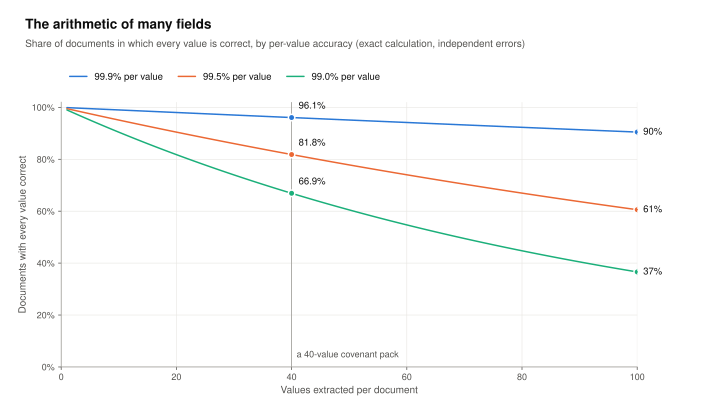
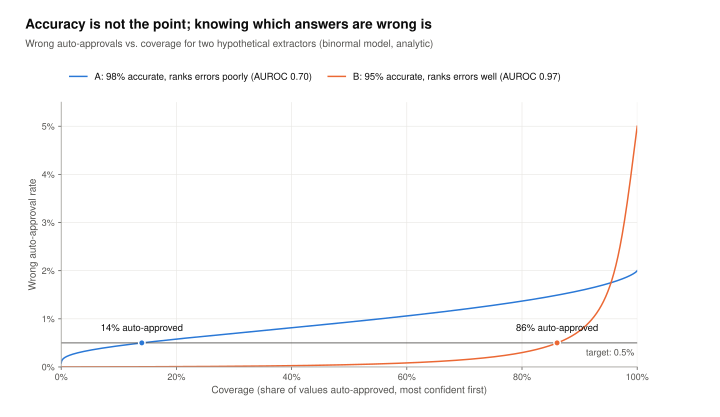
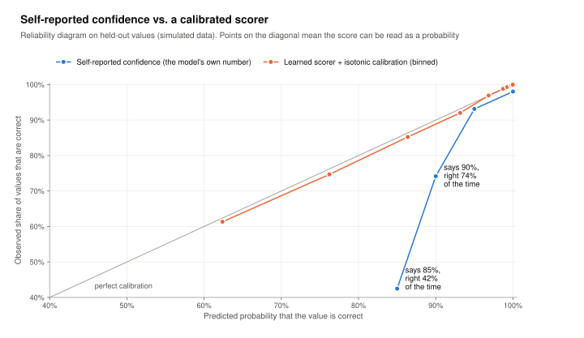

In my [previous post](/blog/reading-financial-documents-with-ai), I described three ways to build pipelines that read financial documents with AI, with a stack of trust layers ending, at the bottom, in a confidence threshold.
I gave that layer a single line: *"necessary, never sufficient"*.
This post is about that line.

Think about the best junior credit analyst you have worked with.
It was probably not the one who never made mistakes.
It was the one who knocked on your door and said: "I'm not sure about this number. The scan is blurry, and it doesn't match last quarter."
An analyst who is right 98% of the time but never tells you which 2% are wrong forces you to re-check everything they hand in.

<figure class="jb_picture">
  {% responsive_image width: "100%" border: "0px solid #808080" path: img/posts/2026/2026-11-24/kungstradgarden-relic.jpg alt: "A carved stone face, part of an architectural relief, embedded in the raw rock wall of a Stockholm metro station" %}
  <figcaption class="stroke">
   &#169; This carved face is not decoration poured for the station. It is a relief salvaged from one of the historic buildings demolished during the redevelopment of central Stockholm in the 1950s and 1960s, and set into the unfinished cave rock of <a href="https://en.wikipedia.org/wiki/Kungstr%C3%A4dg%C3%A5rden_metro_station">Kungsträdgården metro station</a>. A fragment like this is only as trustworthy as your ability to trace it back to where it came from.
  </figcaption>
</figure>

<aside class="quote">
    <em>"A model that never says 'I don't know' has to be checked every time it says anything."</em>
</aside>

Large language models are not good at saying "I don't know."
Most benchmarks give zero points for an honest abstention and some points for a lucky guess, so guessing wins.[^1]
What works is a *confidence layer* around the model: independent signals, a small scorer that combines them, a calibration step that turns the score into a real probability, a threshold with a statistical guarantee, and a review process designed for the moments when the answer is "I don't know."

I'll keep the running example from the last post: covenant monitoring.
Every quarter, a corporate borrower sends a compliance pack; the system extracts a dozen values (EBITDA, net debt, interest expense, and so on), code computes the ratios, and the ratios are tested against the loan agreement's covenants.
Some values are covenant inputs, where an error can hide a breach; others feed analytics, where an error is cheap.

To make every claim checkable, I built a simulation: 24,000 synthetic compliance packs with 12 values each (288,000 values), with realistic error types and the signals a real pipeline would produce.
Every chart and number marked as simulated comes from it; the mechanics are what I would run on real data.

In this post: why abstention is a feature and how to measure it; how extraction fails *confidently* and which signals catch which failures; how to turn signals into a calibrated probability and a threshold you can promise; how to design the human side (review modes, canaries, audits); and how to keep the promise in production, including what supervisors will ask about it.

<figure class="jb_picture">
  
  <figcaption class="stroke">
    Figure 1. The confidence layer: signals are combined into a score, calibrated into a probability, and compared with a certified threshold per tier. Everything else goes to people, with a reason, and becomes labels that retrain and recertify the layer.
  </figcaption>
</figure>

# Why "I Don't Know" Is a Feature

Most document pipelines in banks start with 100% review: the model pre-fills every value, and a person checks all of them.
That is safe, and also where most projects stall, since the bank now pays for a model *and* the same checking as before.

Automation only pays off when you can skip checks, and to skip one you need to know which values don't need it — a different question from "how accurate is the model?", and the one this post answers.

## The Arithmetic of Many Fields

Suppose the extractor is right 99.5% of the time, which is excellent.
A set of financial statements easily has 40 values that matter.
If errors are independent, the chance that *every* value is right is 0.995 to the power of 40, or about 82%.

<figure class="jb_picture">
  
  <figcaption class="stroke">
    Figure 2. The arithmetic of many fields. At 99.5% accuracy per value, roughly one 40-value pack in five contains at least one wrong number, and you can't tell which.
  </figcaption>
</figure>

So roughly one pack in five has a wrong number somewhere, and you can't tell which.
Trusting a whole document lets it through; reviewing it means checking 40 values to find one — the decision has to happen at the level of individual values: *can this go into the database without a person looking at it?*

## A Vocabulary for Abstention

- **Coverage.** The share of values auto-approved; the automation rate.
- **Wrong auto-approval rate (WAR).** The share of auto-approved values that are wrong (*selective risk* in the literature).
- **Abstention.** Routing a value to review, or a document back, instead of trusting it.
- **Straight-through processing (STP).** The share of *documents* with no human touch, always lower than coverage, for the reason above.
- **Risk–coverage curve.** Sort values by confidence and plot coverage against WAR at every cut-off: the single most useful picture of a confidence layer.[^2] [^3]

The number I look at first is *coverage at risk*: at the risk I can accept, how much can I automate?

## Ranking Beats Accuracy

Take two extractors: A is right 98% of the time, but its confidence scores barely separate right from wrong; B is right only 95%, but separates them well.
Which should the bank use?

<figure class="jb_picture">
  
  <figcaption class="stroke">
    Figure 3. Accuracy is not the point; knowing which answers are wrong is. Extractor A auto-approves only 14% of values at 0.5% WAR; extractor B, less accurate but better ranked, auto-approves 86% at the same risk.
  </figcaption>
</figure>

B, by a mile: at a target of 0.5% wrong auto-approvals, A can automate 14% of values and B can automate 86%.
What separates them is *ranking*, the probability a random correct value scores higher than a random wrong one (AUROC), which matters more than accuracy here, since the job is to put wrong values at the bottom of the list.
So "how accurate is your extractor?" is the wrong question for a vendor; ask instead "what coverage do you get at 0.5% WAR on my documents?"

## Chow's Rule: Abstaining Has a Price, and So Does Guessing

Abstention is an economic decision with a clean, old answer: in 1970, C. K. Chow derived the optimal rule for a recognition system allowed to refuse.[^4]
Let $$c_r$$ be the cost of a human review and $$c_e$$ the cost of a wrong value nobody catches; if $$p$$ is the probability the value is correct, auto-approve when:

$$p > 1 - \frac{c_r}{c_e}$$

With a €4 review and a €1,000 undetected error, the bar is 0.996; at €200 it drops to 0.98, at €5,000 it rises to 0.9992.

The rule assumes $$p$$ is a *real* probability: if the system says 0.999 for values right only 99% of the time, it silently approves values meant for people, which is why calibration, covered later, is what makes the threshold mean anything.
A go-around is a normal, blameless option for pilots, never a failure; an abstention should feel the same way inside your system.
The failure is the confident wrong number nobody looked at.

# A Short History of Knowing What You Don't Know

None of the ideas here are new, which is good news: a validator can find textbooks about them.

<figure class="jb_picture">
  
  <figcaption class="stroke">
    Figure 4. Seventy years of teaching machines to abstain. Reject options, calibration, and distribution-free guarantees all predate LLMs by decades.
  </figcaption>
</figure>

The story starts with the weather: in 1950, Glenn Brier proposed scoring probability forecasts by the squared difference between the forecast and what happened,[^5] later formalized as *calibration*, the idea behind the reliability diagram used later in this post.

The reject option was invented for the same problem: in 1957 Chow described a character recognizer that refuses to classify when unsure, and in 1970 worked out the optimal trade-off between errors and rejections.[^4]
Around 2000, machine learning learned to turn classifier scores into probabilities (Platt scaling fits a sigmoid, isotonic regression fits any monotone step function),[^6] both still production workhorses.

Then came the guarantees: conformal prediction wraps any model with error guarantees that hold without model assumptions, as long as the future looks like the calibration data.[^7]
Selective classification formalized the coverage–risk trade-off,[^2] and in 2017 Geifman and El-Yaniv showed how to pick a threshold so the risk of accepted predictions stays below a target with high probability,[^3] the recipe this post's certification follows; in 2021, *Learn then Test* generalized it to almost any tunable parameter.[^8]

That same year, Guo and colleagues showed modern neural networks are far more overconfident than older ones, and that temperature scaling recovers most of the calibration.[^9]
The pattern repeated with language models: pretrained models are reasonably calibrated on multiple-choice questions,[^10] but post-training for chat makes calibration worse, and confidence *stated in words* tends to be overconfident.[^11]
The latest results pull in two directions: reasoning models express better-calibrated confidence, yet reasoning fine-tuning can make abstention worse, and OpenAI researchers argue hallucination persists because training and evaluation reward guessing over admitting uncertainty.[^1]

In one sentence: newer models describe their uncertainty better, but are no more willing to act on it, which is why I don't leave the decision to abstain to the model — it belongs to a layer you own, test, and version.

# How Extraction Fails Confidently

Almost every wrong value falls into one of four buckets, and in each the model is usually *sure* of what it wrote.

<figure class="jb_picture">
  
  <figcaption class="stroke">
    Figure 5. Four ways to be confidently wrong. In each case the model is sure about the characters it produced; the mistake is in where they came from or what they mean.
  </figcaption>
</figure>

**1. Wrong cell.** Every digit is correct, but from the wrong place: last year's column, the parent company, the wrong period.
It's the most common error on clean digital documents and the most dangerous for naive grounding ("is this number on the page?" returns yes).
A *layout* check (column header, row label, current-not-equal-prior rule) catches it.

**2. Misread.** A blurry 3 becomes an 8, dominating on scans; the answer still reads fluently, so confidence stays high.
A second reader, OCR-based grounding, and arithmetic (net debt = gross debt − cash) catch most of these.

**3. Sign or scale.** The model copies `(486)` as `486`, or misses an "EUR thousands" header: every token-level signal says "very sure," but the meaning is wrong.
Reading values *as printed* and applying sign and scale in code, plus accounting identities and history, catch what slips through.

**4. Not printed.** The pack doesn't contain the value and the model invents a plausible one anyway, the classic hallucination, most dangerous since there's nothing on the page to point at.
It's easiest to catch *if you look*: grounding finds no match, a cross-read returns null, and a schema allowing "not found" gives the model a way out.

In the simulation, about 35% of wrong values are wrong-cell, 32% misreads, 19% sign or scale, and 15% not printed; scanned packs (a quarter of the total) have a 15% error rate, against 3% for digital ones.

## Is It the Page or the Reader?

Some doubt comes from the *page* (a blurry scan: *aleatoric* uncertainty, which no modeling removes, so the right response is often to reject the document).
Other doubt comes from the *reader* (an unseen template: *epistemic* uncertainty, which shrinks with data, so the right response is to route to review and feed the result into training).
A good confidence layer keeps the two apart, since the fixes differ.

Token-level confidence measures how sure the model is about *the characters it wrote*; extraction errors are mostly about *where it looked* and *what the characters mean* — a model can be perfectly certain it copied "486," and perfectly wrong that "486" is this year's EBITDA.

<aside class="quote">
    <em>"Fluency is not accuracy. The model is most confident when it copies the wrong number perfectly."</em>
</aside>

This doesn't make the model's confidence useless; it makes it one weak signal among several.

# Let the Model Say It First

The confidence layer doesn't replace asking the model to abstain; it complements it, with a few changes that make "I don't know" cheap to say and turn abstentions into signals code can act on.

**Give it a way out in the schema.** Make every value optional with a status (*found*, *not found*, *illegible*, or *ambiguous*), with a found value carrying the number exactly as printed plus its page, sign and scale applied later in code.
Each status routes differently: *not found* triggers a completeness check, *illegible* is a rejection candidate, *ambiguous* goes to review with all candidates on screen.

**Say abstaining is acceptable, and guessing costs more.** A missing value beats a guessed one: an explicit confidence target (a wrong answer costs points, "I don't know" costs nothing) makes guessing only pay above that confidence,[^1] and the same wording works in an extraction prompt, though prompting alone isn't a cure.

**Ask for evidence, so absence becomes visible.** Requiring a page and a quote for every value, as in the last post, makes a value without evidence detectable.

**Believe abstentions; don't trust their absence.** Treat an "illegible" or "not found" as a hard stop; when the model *doesn't* abstain, the scorer treats its silence as just another weak feature.

**Put unanswerable cases in your gold set.** Any prompt change that makes the model abstain *less* looks like an improvement unless the set includes genuinely missing values and illegible pages, scoring a correct "not found" as correct.

# Where Confidence Comes From

A confidence layer is only as good as the evidence it combines: a panel of imperfect witnesses, each seeing part of the scene, with blind spots in different places.

<figure class="jb_picture">
  
  <figcaption class="stroke">
    Figure 6. Which signal catches which error. No row is strong everywhere, and the strong cells are spread across different rows, the argument for combining signals.
  </figcaption>
</figure>

## The Model's Own View

**Self-reported confidence** (a 0–1 number) is free and better than nothing, but tends to be overconfident[^11] and clusters at a few round values — a weak feature, never a decision.
**Token log-probabilities**, where available, are informative (one uncertain digit is enough to make the whole number wrong) but must be recorded as *missing*, never zero, when an API doesn't expose them.
**Self-consistency** (sampling repeatedly) is a strong hallucination detector for open-ended answers,[^12] [^13] but disappointing for number extraction, since a misread digit tends to repeat the same way: it measures stability, not correctness.

## A Second Reader

A *blind cross-read* has a different model read the same cell without seeing the first answer; in the simulation it's the strongest single signal, especially against misreads and invented values.
Its weakness: models share blind spots.
A study of 350+ LLMs found that when two models are both wrong, they often give the *same* wrong answer, and more accurate models have *more* correlated errors.[^14]
Agreement between two strong models is good evidence, but not independence, and is exactly where wrong-cell errors tend to occur.

## Evidence on the Page and in the Numbers

**Layout and grounding**, from archetype C in the last post (is the value printed inside the box, is its row label next to it, the column header the right period) is strong against misreads and invented values, and catches wrong-cell errors, the one failure grounding alone waves through.
**Accounting identities** give free error detectors: assets equal liabilities plus equity, subtotals equal their lines, net debt equals gross debt minus cash, EBITDA equals operating profit plus depreciation and amortization.
A broken identity doesn't prove which value is wrong, but the pair deserves a look; in the simulation, 8 of 12 fields take part in at least one rule.
**History and context**: comparing a value with the borrower's previous quarters catches scale errors, but a legitimate event (an acquisition, a write-down) also looks like an outlier, so history is a reason to review, never proof of error, and new borrowers have none.
Document context (scanned or digital, known template) shifts the *base rate* rather than pointing at a value; process signals (retries, JSON repairs, fallback models) are evidence too.

## What Combining Buys You

Here is what the simulation says when you use each signal alone, compared with all of them combined by the scorer below; coverage is the share auto-approvable while keeping the observed wrong auto-approval rate at or below 0.5%.

| Signal (simulated, test set)                        | AUROC | Coverage at 0.5% WAR |
|-----------------------------------------------------|------:|---------------------:|
| Self-reported confidence                            |  0.77 |                 0.2% |
| Lowest token log-probability of the value           |  0.62 |                 0.6% |
| Grounding tier                                      |  0.79 |                 0.1% |
| Blind cross-read agrees                             |  0.82 |                 0.0% |
| All signals, learned scorer with calibration        |  0.98 |                  88% |

No single signal isolates a group of values clean enough to meet a 0.5% target; even cross-read agreement leaves a few percent wrong, mostly wrong-cell errors where both readers fell into the same trap.
Combined, the signals cover each other's blind spots and coverage jumps to 88%.
Don't look for the best signal; look for signals that fail in *different* places.

# From Signals to a Probability

Hand-written rules work on day one, but break down as they multiply and interact, with nobody able to say what probability a combination corresponds to.
The cleaner design: a small learned model that turns signals into one number, followed by calibration that makes the number mean something.

<figure class="jb_picture">
  
  <figcaption class="stroke">
    Figure 7. Inside the confidence engine. Everything that decides is learned offline on labeled data, released as one versioned bundle, and applied online without changes.
  </figcaption>
</figure>

## The Scorer

I use gradient-boosted trees: they handle missing values natively, capture interactions, train in seconds, and can be constrained in ways a validator can check.
Inputs are the signals above plus document features; the target is whether the value was right.

Three choices matter.
**Monotone constraints**: a better grounding tier can never *lower* the score, and a failed rule can never raise it, so the scorer can't learn spurious patterns from a few thousand labels.
**Grouped splits**: a borrower's packs share a template and often the same mistakes, so every borrower lands in exactly one of training, calibration, or test (about 5,900 borrowers split 50/25/25); in a real portfolio I'd also split by time.
**Missing stays missing**: the trees learn what "missing" means from data, far safer than filling with zeros or averages.

## What Calibration Means

The scorer's output is not yet a probability for Chow's rule.
A *calibrated* score is one where, among values scored 0.9, about 90% really are right, the weather forecaster's property applied to a PDF.
The check is a *reliability diagram*: bin held-out values by predicted probability and plot the observed correct share; a calibrated score sits on the diagonal.

<figure class="jb_picture">
  
  <figcaption class="stroke">
    Figure 8. Self-reported confidence vs. a calibrated scorer (simulated). When the model says 90%, it is right 74% of the time; the calibrated scorer can be read as a probability.
  </figcaption>
</figure>

In the simulation, the model's self-reported confidence says "1.0" for 61% of values, right only 98% of the time, far below the 0.996 bar from Chow's rule.
The calibrated scorer stays on the diagonal into the tail (expected calibration error 0.0011 vs. 0.032).

Three standard methods: **Platt scaling** fits a two-parameter sigmoid, robust with little data but limited in shape.
**Isotonic regression** fits any non-decreasing step function, more flexible but needs more data (past roughly a thousand examples).[^15]
**Temperature scaling** divides a network's own logits by one learned constant,[^9] the right tool for calibrating a network's own outputs, not a separate scorer.

With tens of thousands of labels, I use isotonic regression, fitted separately per segment (digital vs. scanned): a scanned page and a digital page with the same raw score aren't equally likely to be right, and one curve averages them into something true for neither.
A segment never seen in calibration gets probability zero, routing every value from it to review.

## Calibration in the Tail

Expected calibration error is an average over all values, and most values are easy.
A scorer can have a tiny overall error and still be off exactly where thresholds sit, above 0.99, where half a point of error doubles your real error rate.
So I always check the reliability diagram with narrow bins near 1, and the number of values in each: if the top bins hold only a few hundred, the calibration there is a guess.

# Choosing the Threshold

With a calibrated probability for every value, one decision remains: where to draw the line.
A bank needs both an economic answer and a risk answer.

## Option 1: Price It

Chow's rule gives the threshold directly from two costs.
Figure 9 shows the expected cost of every policy across the simulated portfolio, relative to reviewing everything.

<figure class="jb_picture">
  
  <figcaption class="stroke">
    Figure 9. The cheapest threshold depends on what an error costs (simulated): automation cuts total cost to 31% at €200 per error, but only to 91% at €5,000.
  </figcaption>
</figure>

The optimal coverage moves a lot with the cost of an error: 82% of values at €200 per error, 64% at €1,000, 23% at €5,000.
The curves are flat near their minimum and steep after it, so under-automating is cheap and over-automating is expensive; at high error costs the whole exercise saves little.

Since the cost of an error isn't one number (a wrong covenant EBITDA matters far more than a wrong headcount), I group fields into *tiers* by the cost of an undetected error and certify a threshold per tier (tier 1 covenant inputs, tier 2 credit-memo values, tier 3 analytics).

## Option 2: Promise It

A risk officer rarely asks what the threshold costs; they ask what you can *promise*.
"The scorer says 0.996" is an estimate from finite data, not a promise like:

> With 95% confidence, at most 0.3% of the tier-1 values we auto-approve are wrong.

That needs an *upper bound* on the error rate among accepted values, not just the observed rate.
The classic tool is the Clopper–Pearson bound for a binomial proportion:[^16] with $$n$$ accepted values and $$k$$ errors, the true rate is below the bound at the chosen confidence.
A useful special case, the *rule of three*: zero errors in $$n$$ values gives a 95% upper bound of about $$3/n$$, so zero in 3,000 supports "below 0.1%," and zero in 300 only "below 1%."

Certification checks 25 candidate thresholds, computing the upper bound on the calibration split for each, and keeps the most lenient one whose bound still meets the target; if none qualifies, nothing is certified and nothing in that tier is automated.

Two details matter: **the grid is fixed before looking at the data** (scanning every threshold and picking the best-looking one tests hundreds of hypotheses and reports the luckiest, so certification splits the error budget across the 25 fixed candidates, each at 0.05/25, a Bonferroni correction, so the 95% holds simultaneously for all of them)[^3] — *Learn then Test* offers sharper procedures,[^8] but Bonferroni is the version I can explain to a validator on a whiteboard — and **certification uses its own data**: thresholds are certified on the calibration split, and reported numbers come from the untouched test split.

<figure class="jb_picture">
  
  <figcaption class="stroke">
    Figure 10. A guarantee costs coverage (simulated). The threshold where the observed rate hits target would automate 66%; requiring the upper bound to clear it automates 43%.
  </figcaption>
</figure>

With a single global target of 0.2%, the observed error rate stays under target up to 66% coverage, but a threshold placed there is right only on average, and the next batch would exceed 0.2% about half the time.
The certified threshold, requiring the upper bound to clear the target, automates 43% instead (30,398 values, 36 errors, 0.12%, bound just under 0.2%); the missing 23 points of coverage are the price of a promise you can defend.

With one threshold per tier, the simulated system on the untouched test split:

| Tier (simulated)        | Target WAR | Certified threshold | Coverage on test | Observed WAR on test |
|-------------------------|-----------:|--------------------:|-----------------:|---------------------:|
| 1: covenant inputs      |       0.3% |              0.9955 |              70% |                0.13% |
| 2: credit memo values   |       0.5% |              0.9841 |              81% |                0.30% |
| 3: analytics values     |       1.0% |              0.9437 |              91% |                0.83% |

Overall, 81% of the values are auto-approved, with every tier inside its target.

## Where Conformal Prediction Fits

This is the structure of conformal prediction: hold out calibration data, compute a statistic on it, and set a threshold so a guarantee holds for new data.[^17]
All of it rests on *exchangeability* — new documents must look like the calibration ones, statistically; a new template, model version, or market wave breaks that, which I return to in the production section.

## Averages Hide Segments

The guarantee is about the *average* over a tier.
In the simulation, tier 3 met its 1% target overall (0.83%), but inside it scanned auto-approvals were wrong 1.9% of the time, almost double target, against 0.55% for digital; nothing was broken, the math promised an average and delivered one.

If a segment matters on its own, it must be certified on its own.
With about 6,000 calibration values per tier for scans, no threshold can be certified for scanned documents at all, and value-level automation drops from 81% to 67% as every scanned value goes to people — turning a vague debate ("are we ready to automate scans?") into a concrete plan for how many labeled scans to collect.

# The "I Don't Know" Path

A threshold is just a number until something acts on it.
The routing function should be short, boring, and impossible to misread: are the required signals present? Is the probability valid? Does the tier have a certified threshold? Does it clear it?
One "no" sends the value to review; four "yes" answers auto-approve it.

**Every decision comes with a reason** that travels into the queue, the audit log, and the dashboards.
**Anything unusual fails closed**: a missing signal, an out-of-range score, or a tier with no certified threshold all route to review regardless of the score.
**The policy is a frozen, versioned object**, loaded from the same bundle as the scorer and calibrator.
**Documents are routed after values**: a pack flows straight through only if *every* tier-1 value was auto-approved — this is Figure 2 again: 81% of values are auto-approved, but only 43% of packs pass straight through, since each pack has four tier-1 values and all must clear the strictest threshold.

## One Pack, End to End

Here is one simulated pack followed through the layer, a clean digital document from a known template, the kind expected to sail through.

| Value                  | Tier | What the signals said                                                                                             |     p | Decision                    | Truth                          |
|------------------------|:----:|-------------------------------------------------------------------------------------------------------------------|------:|-----------------------------|--------------------------------|
| EBITDA                 |  1   | Grounded exactly, rules pass, but the blind cross-read *disagrees*                                              | 0.966 | Review: below 0.9955        | Correct; the second reader erred |
| Net debt               |  1   | Every signal agrees                                                                                               | 0.998 | Auto-approve                | Correct                        |
| Interest expense       |  1   | Every signal agrees                                                                                               | 0.999 | Auto-approve                | Correct                        |
| Total equity           |  1   | Every signal agrees                                                                                               | 0.997 | Auto-approve                | Correct                        |
| Operating cash flow    |  2   | Only a numeric match on the page, cross-read disagrees, a rule fails, 4.4 standard deviations from history; self-reported confidence 0.95 | 0.000 | Review: below 0.9841        | Wrong: sign dropped            |
| Dividends paid         |  3   | Numeric match on the page, cross-read agrees, no rule covers it; self-reported confidence 1.0                     | 0.966 | Auto-approve: above 0.9437  | Wrong: last year's column      |
| Six other values       | 2–3  | Every signal agrees                                                                                               |  ≥0.996 | Auto-approve              | Correct                        |

Three things happen here, and together they summarize the post.
The operating cash flow error is caught easily: the model was 95% sure, but three signals disagreed, and the scorer gave it essentially no chance.
EBITDA goes to review even though it's correct, because the second reader disagreed (the price of caution), and the whole pack waits since it's tier 1.
The dividends value shares EBITDA's 0.966 probability but gets the opposite decision, since tier 3's threshold is lower, and it's wrong, a wrong-cell error no accounting rule covers.
That's what a 1% error budget looks like from the inside; if that's unacceptable for dividends, move the field to a stricter tier rather than hope the next pack is luckier.

## Three Outcomes, Not Two

Abstention isn't binary: I need three outcomes: **auto-approve** (stored with full lineage), **review** (a person decides, with evidence and reason on screen), and **reject** (the document is unusable; the right action is asking the borrower for a better copy).
Rejection matters because sending a blurry scan to a reviewer just moves the guessing from a model to a person.

## The Queue Is a Product

Once abstention is routine, the review queue is a production system with its own design questions.

**Priority**: sort by materiality times doubt, with anything blocking a covenant test first.
**Capacity**: queues obey Little's law; (illustratively) 400 packs a day with 12 values each, at 81% coverage, puts about 900 values a day into review, 5 reviewer-hours at 20 seconds each, with about 450 values in the queue at a half-day target wait.
**Who reviews what**: route scans to people good with scans, new templates to people who can update the template library, and measure each queue separately.
**Never let the queue move the threshold**: a queue overflow is an operations problem, solved with more reviewers or priority, never a weaker promise.

# Designing the Human Side

Everything so far assumes a value sent to review gets *reviewed*, the weakest link in most human-in-the-loop systems.
People who supervise automation tend to over-trust it: the literature calls this *automation bias*, which gets stronger as the machine gets more reliable and the operator gets busier.[^18]
The EU AI Act names it explicitly, requiring that overseers of high-risk systems stay aware of their tendency to over-rely on the system.[^19]
A review step that rubber-stamps the model's output gives the *appearance* of oversight with none of the substance.

<figure class="jb_picture">
  
  <figcaption class="stroke">
    Figure 11. Confirm mode is fast but invites anchoring; blind mode is slower but turns the reviewer into an independent second reader; canaries measure whether the human layer still works.
  </figcaption>
</figure>

## Confirm or Re-Key

In *confirm mode*, the reviewer sees the model's value next to the page and clicks correct or edit: fast, but the value anchors the reviewer, and "correct" becomes a reflex.
In *blind mode*, the reviewer sees only the page and types what they read, and code compares the two: slower, but a genuinely independent second reader.
This mirrors controlled experiments on manually entered data: double entry produced significantly fewer errors than visual checking, which was no better than no checking at all.
So I use **blind mode** for tier-1 values, new templates, and every random audit, and **confirm mode** where speed matters more and an occasional miss is cheap.

## The Prevalence Trap

Humans are much worse at finding rare things: in visual search experiments, targets appearing in only a small fraction of trials are missed far more often than common ones.[^20]
The confidence layer helps here: by routing only doubtful values to people, it *concentrates* errors in the queue.
In the simulation, 5.7% of all values are wrong, but 27% of queued values are wrong, and 19% of values sent to review contain 93% of all errors.
The same logic works against you in random audits, though: audited values come from the auto-approved pool, where the error rate is tiny, so audits must be blind, and they need canaries.

## Canaries

Airport security's *threat image projection* inserts pre-recorded threat images into real bags so screeners regularly encounter targets and their catch rate can be measured; a *canary* does the same for review queues, a value the system knows is wrong, injected on purpose.
To make canaries useful: **make them realistic** (generate from confirmed values using the failure modes of Figure 5); **keep them rare but steady** (1–2% of items); **give feedback** when caught or missed; and **make them impossible to store**, tagged and filtered before every write.
The canary catch rate tells you whether the human layer is still working.

## What the Reviewer Should See

Not the model's probability, which invites anchoring ("0.97, probably fine"); show the *reason* and the *evidence* instead ("cross-read disagrees: 1,836 vs. 1,886"), which invites a check.
Attention is finite: detection rates in monotonous monitoring drop noticeably after about half an hour, so short sessions and mixing review modes are part of the error budget, not a perk.

# Where the Truth Comes From

Every number in this post depends on labels: values someone confirmed as right or wrong.
In a simulation, truth is free; in production it must be collected, and *how* decides what it can tell you.

<figure class="jb_picture">
  
  <figcaption class="stroke">
    Figure 12. Where labels come from. Only random audits measure the error rate of what was auto-approved; every other source is biased in a known direction.
  </figcaption>
</figure>

## Review Decisions Are Biased by Design

Review labels are the most abundant, but they only exist for values the scorer *doubted*, never for auto-approved ones, which is exactly the population whose error rate you need.
This is the *selective labels problem*:[^21] when a decision determines which outcomes get observed, the observed outcomes can't evaluate the decision.
Review labels are excellent for training the next scorer, useless for estimating the wrong auto-approval rate.

## Random Audits Are the Only Meter

Measuring the auto-approved error rate needs a *random* sample, re-keyed blind, with canaries mixed in.
If strata are sampled at different rates, weight each by the inverse sampling probability (Horvitz–Thompson), or report each stratum separately.

<figure class="jb_picture">
  
  <figcaption class="stroke">
    Figure 13. To claim a wrong auto-approval rate below 0.1% with 95% confidence, you need about 3,000 clean audited values; each wrong value found raises the bar by roughly 1,500 to 1,750 more.
  </figcaption>
</figure>

The same upper bound that certifies a threshold tells you the sample size you need: about 3,000 clean audited values to claim "below 0.1%" with 95% confidence; find one error and you need about 4,700, find two, about 6,300.
At a 1% target the numbers are about 300, 470, and 630; every halved target roughly doubles the audit bill.
Ask for audit capacity in the right currency, "3,000 tier-1 values per quarter," not "2% of volume."

## The Gold Set Has Errors Too

The gold set from the last post is a stable yardstick for comparing versions offline, but it's curated (never use it to estimate production error rates) and has errors of its own: one study found label errors in at least 3.3% of test examples across ten popular ML benchmarks.[^22]
If it was keyed once, by one person, assume it has errors; key it twice, blind, and adjudicate disagreements.

## Corrections From Downstream

Restatements and analyst corrections are free audit results that arrive on their own, but late and biased toward the errors someone happened to notice.
Treat them as a smoke alarm, not a meter: every hit deserves a root-cause analysis, but the count tells you little about the rate.

# Keeping the Promise in Production

A certified threshold promises something about documents that look like the calibration data.
Production is where that stops being true: new borrowers, changed templates, a provider updating the model behind the same API, a market shift.
Keeping the promise means noticing when its assumptions break, and reacting by failing closed.

<figure class="jb_picture">
  
  <figcaption class="stroke">
    Figure 14. Automation levels are earned slowly and lost fast: promotion needs evidence and sign-off, demotion is automatic, and a stop button can send everything to people at any time.
  </figcaption>
</figure>

## Automation Is a Level, Not a Switch

I manage automation as a state machine: *shadow* (model runs, people do all the work, labels collected), *assist* (model pre-fills, every value reviewed, tier-1 blind), *partial* (starts once a threshold is certified and someone accountable signs off), and *straight-through* (last, after audits confirm the error rate long enough to trust it).
Moving up requires evidence, a person, and time; moving down is automatic and immediate — that's failing closed at the system level.

A threshold is certified for a specific scorer, calibrator, extraction model, prompt, and document population; change any of them and the certificate expires, so the whole bundle is versioned: a new bundle runs in shadow next to the current one and is recertified on fresh labels before deciding anything.

## What to Monitor

Roughly in order of how early they warn you: **signal availability** (did a provider silently drop log-probabilities?), **score distribution** (vs. calibration data, per tier), **coverage** (a drop costs money; a jump is a bigger worry), **reasons mix** (a new top reason usually means a broken component), **audited WAR with its bound**, **canary catch rate**, and **override rate** (near-zero may mean miscalibration).

*Adaptive conformal inference* can nudge a threshold after each outcome to keep the long-run error rate on target as data shifts.[^23]
I'd use it as an *early warning* rather than to move the production threshold itself: that's a documented risk decision with an owner, and the state machine above gives the same protection without the novelty.

# What the Layer Costs

Budget for: **model calls** (the blind cross-read roughly doubles calls for values it covers); **labels** (thousands per tier, collected from day one in shadow mode); **audits** (roughly 3,000 blind re-keyed values per tier and period for "below 0.1%"); **reviewers** (sized for the peak); and **engineering** (versioned bundles, shadow deployments, a blind-mode review interface, and the monitors above).

In the simulation, the layer auto-approves 81% of values with every tier inside target, and total costs fall to between 31% and 91% of full review depending on what an error costs.
The harder-to-price benefit: the bank can state an error rate for its automated data with a confidence level attached, and back it with evidence.

# What Supervisors Will Ask

A confidence layer is a good answer to what a supervisor or model validator will ask about an AI system that reads documents (an engineer's reading, not legal advice).

**The EU AI Act** requires, in Article 14, that high-risk systems let people oversee them effectively and stay aware of automation bias;[^19] Article 15 requires declaring accuracy levels and the metrics used to measure them,[^24] a certified wrong auto-approval rate per tier being exactly such a metric.
Covenant monitoring for corporate borrowers is generally not on Annex III's high-risk list,[^25] but an extraction step feeding a creditworthiness assessment may well be in scope from 2 December 2027, after the Digital Omnibus.

**BCBS 239**'s principles on risk data require accuracy and reliability achieved on a *largely automated* basis;[^26] a confidence layer is how you automate without losing the ability to show the automated part is accurate.

**Model risk management**: the Federal Reserve's SR 11-7 was superseded in April 2026 by SR 26-2.[^27]
It excludes generative and agentic AI as novel, but defines a model as a method applying statistical theory to turn data into quantitative estimates — the confidence scorer fits that definition squarely, and should be validated like a classic bank model: conceptual soundness, ongoing monitoring, and outcomes analysis via random audits.

Here is how the pieces of this post map to what these frameworks ask for:

| What they ask for                                     | Where it lives in the confidence layer                                  |
|-------------------------------------------------------|--------------------------------------------------------------------------|
| Declared accuracy levels and metrics                  | Certified WAR per tier and segment, with confidence and data period      |
| Oversight that resists automation bias                | Blind review for tier 1, canary catch rates, reasons instead of scores   |
| The ability to override, reject, and stop             | Reject outcome, stop button, automation levels that fail closed          |
| Accurate data, largely automated, with controls       | Grounding, rules, lineage per value, random audits                       |
| Ongoing monitoring and outcomes analysis              | Drift monitors, audited WAR with bounds, recertification per version     |

# A Checklist

Before letting a confidence layer approve anything on its own, check it against this list:

- [ ] The scorer combines several signals that fail in different places; the model's self-reported confidence is, at most, one of them.
- [ ] Missing signals stay missing, and the policy routes values with missing required signals to review.
- [ ] Training, calibration, certification, and testing use separate data, split by borrower (and by time).
- [ ] Calibration is checked in the tail, near the thresholds, per segment.
- [ ] Each tier has a target error rate and a threshold certified with an upper bound on held-out data, and segments that matter on their own are certified on their own.
- [ ] Every routing decision carries a reason, and a reject outcome exists for unusable documents.
- [ ] Tier-1 values and random audits are reviewed blind, and canaries measure the reviewers.
- [ ] The wrong auto-approval rate is measured on random audits, never on review decisions, and the audit size matches the claim.
- [ ] Scorer, calibrator, thresholds, model, and prompt are versioned as one bundle, and any change sends the system back to certification.
- [ ] Demotion to a lower automation level is automatic, and anyone accountable can stop automation entirely.

# Conclusion

LLMs made reading financial documents cheap, not trusting what they read, and the instinct to fix that with a better model or cleverer prompt misses where the problem lives.
A system that cannot say "I don't know" has to be checked every time it says anything, so all the value of automation hides in the values you can safely skip — a measurement problem with a well-understood toolbox: signals, a scorer, calibration, certified thresholds, and humans in a loop that is designed rather than assumed.

Five core lessons:

1. **Rank before you threshold.** A model that knows when it is wrong beats a more accurate one that doesn't. Measure coverage at your target risk, not accuracy.
2. **Never trust a single signal, least of all the model's own opinion.** Combine evidence that fails in different places: a second reader, grounding, layout, accounting rules, and history.
3. **Make the probability honest, then make a promise.** Calibrate on held-out data per segment, and choose thresholds with an upper bound, not an average. When the data can't support a promise, the honest answer is "review it all."
4. **Design the "I don't know" path.** Reasons on screen, blind review where it matters, canaries to measure the reviewers, and a reject button for pages nobody can read.
5. **Measure with random audits, and fail closed.** Only random audits tell you the error rate of what you automated. When the evidence weakens, automation should step down by itself.

The best junior analysts learn early that "I'm not sure about this one" is not an admission of weakness; it's what makes everything else they say worth trusting.
Our systems should learn the same thing.

# Footnotes

[^1]: Adam Tauman Kalai et al., [_Why Language Models Hallucinate_](https://arxiv.org/abs/2509.04664) (arXiv, 2025).

[^2]: Ran El-Yaniv and Yair Wiener, [_On the Foundations of Noise-free Selective Classification_](https://jmlr.org/papers/v11/el-yaniv10a.html) (JMLR, 2010).

[^3]: Yonatan Geifman and Ran El-Yaniv, [_Selective Classification for Deep Neural Networks_](https://arxiv.org/abs/1705.08500) (NeurIPS, 2017).

[^4]: C. K. Chow, [_On Optimum Recognition Error and Reject Tradeoff_](https://doi.org/10.1109/TIT.1970.1054406) (IEEE Transactions on Information Theory, 1970).

[^5]: Glenn W. Brier, [_Verification of Forecasts Expressed in Terms of Probability_](https://doi.org/10.1175/1520-0493%281950%29078%3C0001%3AVOFEIT%3E2.0.CO%3B2) (Monthly Weather Review, 1950).

[^6]: Bianca Zadrozny and Charles Elkan, [_Transforming Classifier Scores into Accurate Multiclass Probability Estimates_](https://doi.org/10.1145/775047.775151) (KDD, 2002).

[^7]: Vladimir Vovk, Alexander Gammerman, and Glenn Shafer, [_Algorithmic Learning in a Random World_](https://doi.org/10.1007/b106715) (Springer, 2005).

[^8]: Anastasios N. Angelopoulos et al., [_Learn then Test: Calibrating Predictive Algorithms to Achieve Risk Control_](https://arxiv.org/abs/2110.01052) (arXiv, 2021).

[^9]: Chuan Guo et al., [_On Calibration of Modern Neural Networks_](https://arxiv.org/abs/1706.04599) (ICML, 2017).

[^10]: Saurav Kadavath et al., [_Language Models (Mostly) Know What They Know_](https://arxiv.org/abs/2207.05221) (arXiv, 2022).

[^11]: Miao Xiong et al., [_Can LLMs Express Their Uncertainty? An Empirical Evaluation of Confidence Elicitation in LLMs_](https://arxiv.org/abs/2306.13063) (ICLR, 2024).

[^12]: Xuezhi Wang et al., [_Self-Consistency Improves Chain of Thought Reasoning in Language Models_](https://arxiv.org/abs/2203.11171) (ICLR, 2023).

[^13]: Sebastian Farquhar et al., [_Detecting Hallucinations in Large Language Models Using Semantic Entropy_](https://doi.org/10.1038/s41586-024-07421-0) (Nature, 2024).

[^14]: Elliot Kim et al., [_Correlated Errors in Large Language Models_](https://arxiv.org/abs/2506.07962) (ICML, 2025).

[^15]: Alexandru Niculescu-Mizil and Rich Caruana, [_Predicting Good Probabilities with Supervised Learning_](https://doi.org/10.1145/1102351.1102430) (ICML, 2005).

[^16]: C. J. Clopper and E. S. Pearson, [_The Use of Confidence or Fiducial Limits Illustrated in the Case of the Binomial_](https://doi.org/10.1093/biomet/26.4.404) (Biometrika, 1934).

[^17]: Anastasios N. Angelopoulos and Stephen Bates, [_A Gentle Introduction to Conformal Prediction and Distribution-Free Uncertainty Quantification_](https://arxiv.org/abs/2107.07511) (arXiv, 2021).

[^18]: Raja Parasuraman and Dietrich H. Manzey, [_Complacency and Bias in Human Use of Automation: An Attentional Integration_](https://doi.org/10.1177/0018720810376055) (Human Factors, 2010).

[^19]: European Union, [_Regulation (EU) 2024/1689 (Artificial Intelligence Act), Article 14: Human Oversight_](https://artificialintelligenceact.eu/article/14/) (2024).

[^20]: Jeremy M. Wolfe, Todd S. Horowitz, and Naomi M. Kenner, [_Rare Items Often Missed in Visual Searches_](https://doi.org/10.1038/435439a) (Nature, 2005).

[^21]: Himabindu Lakkaraju et al., [_The Selective Labels Problem: Evaluating Algorithmic Predictions in the Presence of Unobservables_](https://doi.org/10.1145/3097983.3098066) (KDD, 2017).

[^22]: Curtis G. Northcutt, Anish Athalye, and Jonas Mueller, [_Pervasive Label Errors in Test Sets Destabilize Machine Learning Benchmarks_](https://arxiv.org/abs/2103.14749) (NeurIPS Datasets and Benchmarks, 2021).

[^23]: Isaac Gibbs and Emmanuel Candès, [_Adaptive Conformal Inference Under Distribution Shift_](https://arxiv.org/abs/2106.00170) (NeurIPS, 2021).

[^24]: European Union, [_Regulation (EU) 2024/1689 (Artificial Intelligence Act), Article 15: Accuracy, Robustness and Cybersecurity_](https://artificialintelligenceact.eu/article/15/) (2024).

[^25]: European Union, [_Regulation (EU) 2024/1689 (Artificial Intelligence Act), Annex III_](https://artificialintelligenceact.eu/annex/3/) (2024).

[^26]: Basel Committee on Banking Supervision, [_Principles for effective risk data aggregation and risk reporting (BCBS 239)_](https://www.bis.org/publ/bcbs239.pdf) (BIS, 2013).

[^27]: Board of Governors of the Federal Reserve System, [_SR 26-2: Revised Guidance on Model Risk Management_](https://www.federalreserve.gov/supervisionreg/srletters/SR2602.htm) (2026).
