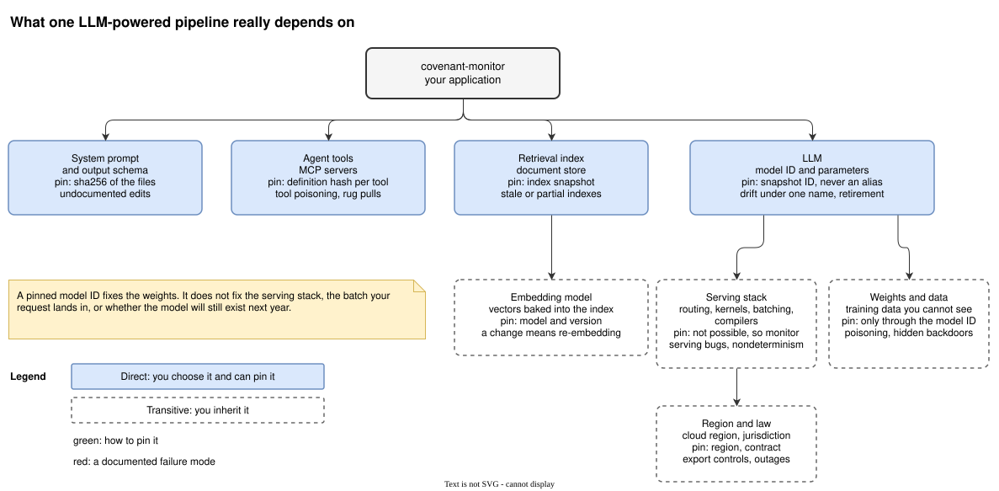
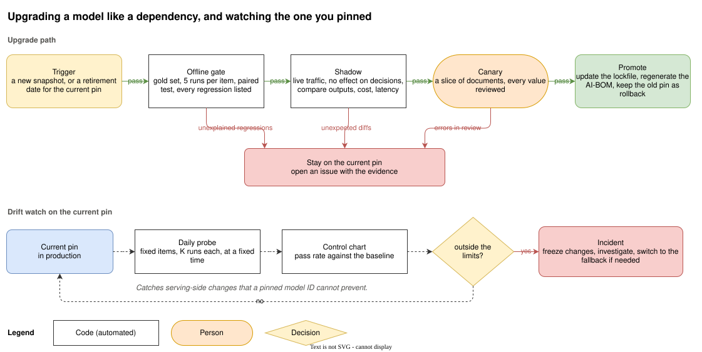
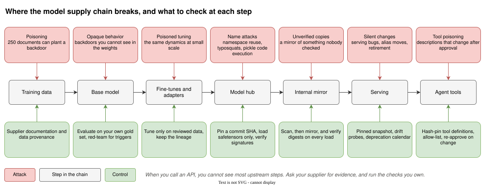
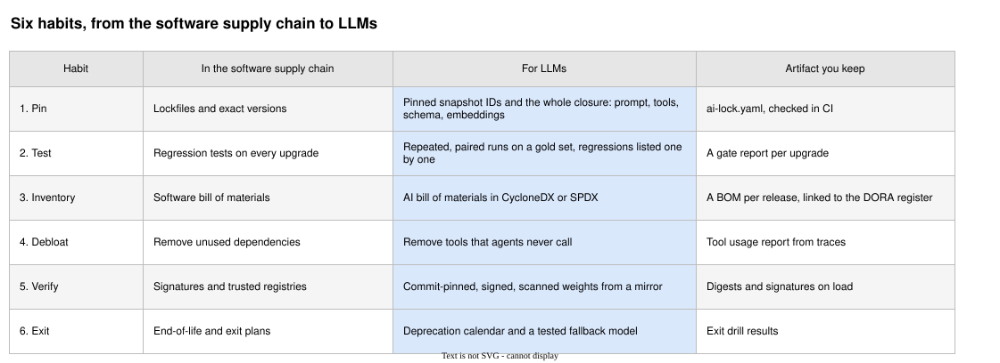

In December 2021, a critical flaw in Log4j, a small Java logging library used almost everywhere, sent organizations around the world scrambling to answer one question: *where do we use it?*[^1]
Teams with an inventory of their dependencies answered in hours, and everyone else started grepping (I wrote about it in [an earlier post](/blog/why-debloating-third-party-software)).

Now ask the AI version: *which of our systems call which model, at which version, with which prompt, and with access to which tools?*
In a 2026 benchmark of 26 systemically important banks, fewer than half had a centralized, tool-based AI inventory, and 46% had experienced an AI-related issue or incident in the previous twelve months.[^2]

During [my PhD at KTH](/files/thesis/2023_debloating-java-dependencies_kth-phd-thesis_cesar-soto-valero.pdf), I studied how software dependencies bloat, break, and quietly turn into liabilities.[^3] [^4]
This post makes a simple argument: a large language model is a dependency.
It is the strangest one we have adopted (no source code, no semantic versioning, and a retirement date), but the software supply chain playbook applies to it almost line by line.

<aside class="quote">
    <em>“You can pin a model’s name. You cannot pin the computation behind it.”</em>
</aside>

The running example is the covenant pipeline from [my post on reading financial documents](/blog/reading-financial-documents-with-ai), which extracts values like EBITDA and net debt from borrowers' quarterly reports.
I'll cover what such a pipeline really depends on, six habits from the software supply chain (pin, test, inventory, debloat, verify, and exit) with code you can adapt, and why financial institutions should adopt them ASAP.

<figure class="jb_picture">
  {% responsive_image width: "100%" border: "0px solid #808080" path: img/posts/2026/2026-11-26/rail-network-map.jpg alt: "Detail of the Stockholm rail network map, with metro, commuter rail, and light rail lines converging on T-Centralen" %}
  <figcaption class="stroke">
   &#169; The rail network map at a Stockholm station. Every line looks independent until you notice that most of them pass through <a href="https://en.wikipedia.org/wiki/T-Centralen_metro_station">T-Centralen</a>. Dependency graphs work the same way: one shared node you never chose can stop everything downstream.
  </figcaption>
</figure>

# What You Actually Depend On

On paper, the covenant pipeline has one dependency: "the model."
Figure 1 shows the real graph.
As in any package manager, there are *direct* dependencies, which you choose and can pin, and *transitive* ones, which arrive with them.

<figure class="jb_picture">
  
  <figcaption class="stroke">
    Figure 1. What one LLM-powered pipeline really depends on. Direct dependencies can be pinned. Transitive ones arrive with them, and some (like the provider's serving stack) cannot be pinned at all, only monitored.
  </figcaption>
</figure>

This dependency misbehaves in ways a library never does.

**The same name, a different model.**
Researchers who tracked GPT-4 found that its accuracy at identifying prime numbers fell from 84% in March 2023 to 51% in June 2023.[^5]
Code that called the moving name got whichever version was current.

**The same model, a different computation.**
Between August and early September 2025, three infrastructure bugs degraded some of Claude's responses: requests misrouted to servers configured for a longer context window, a TPU misconfiguration that corrupted output tokens, and a compiler bug in approximate top-k selection that could drop the most likely token.[^6]
The weights never changed, and Anthropic's evaluations did not catch the degradation at first: a transitive dependency failed behind a model ID that stayed the same.

**The same request, a different answer.**
Thinking Machines sent one prompt 1,000 times to an open model at temperature zero and got 80 distinct completions.[^7]
The cause: the batch your request lands in depends on server load, and GPU kernels for matrix multiplication and attention do not produce bit-identical results across batch sizes.
Batch-invariant kernels made all 1,000 completions identical, at about 1.6 times the runtime.

With a hosted model, you can pin the name (and, if the provider guarantees it, the weights), but not the computation.
Temperature zero is not a lockfile.
And there is no semantic versioning for behavior: the API (JSON in, JSON out) almost never breaks, while the behavior on your task can change with any snapshot.
Treat every model change as a major version.

# Habit 1: Pin the Whole Closure

First, learn your provider's version semantics, the way you learn whether `^1.2.3` floats in npm.
For Anthropic's models before the 4.6 generation, `claude-sonnet-4-5-20250929` is a fixed snapshot and `claude-sonnet-4-5` is an alias that moves.
From the 4.6 generation onward, the dateless ID is itself a pinned snapshot.[^8]
OpenAI lists both moving names like `gpt-5` and dated snapshots like `gpt-5-2025-08-07`.[^9]

Second, pin more than the model.
The pipeline's behavior depends on everything in Figure 1 that *can* be pinned.
Build systems like Nix call the full set of things a build depends on its *closure*, and that is the right unit here:


# ai-lock.yaml for covenant-monitor (hashes shortened)
release: 3.2.0
model:
  provider: provider-a
  id: model-x-2026-09-15            # a pinned snapshot, never an alias
  region: eu-north                  # residency is part of the contract
  params: {temperature: 0, max_output_tokens: 2048}
prompt:
  file: prompts/extract_covenants.md
  sha256: 9f2c71d0...               # an edit is a release
output_schema:
  file: schemas/covenant_values.json
  sha256: 0b7e44a1...
tools:                              # only the tools this agent actually calls
  - name: filings_search
    server: filings-mcp 1.4.0
    definition_sha256: 3c91f0aa...  # name, description, and input schema
retrieval:
  embedding_model: embed-v3-2026-05-01  # changing it means re-embedding everything
  index_snapshot: 2026-11-20
gate:
  gold_set: covenant-gold-v7
  runs_per_item: 5
fallback:
  provider: self-hosted
  id: open-model-y
  revision: 4f1c3e0b8d6a...         # a commit SHA on the model hub


Every line is a release lever, including the prompt, which teams rarely treat that way: in a study of 1,262 prompt changes across 243 open-source repositories, only 21.9% were documented in commit messages.[^10]

A lockfile is only useful if something enforces it.
This check runs in CI, at startup, and every time an MCP server lists its tools:


import hashlib
import json
from datetime import date, timedelta
from pathlib import Path

import yaml

MIN_RUNWAY = timedelta(days=90)  # time we need to migrate before a pin retires

def sha256_file(path: Path) -> str:
    digest = hashlib.sha256()
    with path.open("rb") as f:
        for chunk in iter(lambda: f.read(1 << 20), b""):
            digest.update(chunk)
    return digest.hexdigest()

def tool_fingerprint(tool: dict) -> str:
    """Hash of what the model reads: the tool's name, description, and input schema."""
    seen = {k: tool.get(k) for k in ("name", "description", "inputSchema")}
    return hashlib.sha256(json.dumps(seen, sort_keys=True).encode()).hexdigest()

def verify_lock(lock_file: Path, catalog: dict, live_tools: list[dict], today: date) -> list[str]:
    """Return every reason why the running system no longer matches its lockfile."""
    lock, root, problems = yaml.safe_load(lock_file.read_text()), lock_file.parent, []
    for part in ("prompt", "output_schema"):
        if sha256_file(root / lock[part]["file"]) != lock[part]["sha256"]:
            problems.append(f"{part}: {lock[part]['file']} changed without a release")
    for role in ("model", "fallback"):
        model_id = lock[role]["id"]
        entry = catalog.get(model_id, {})
        if entry.get("kind") != "snapshot":
            problems.append(f"{role}: {model_id} is not a pinned snapshot")
        elif entry.get("retires") and entry["retires"] - today < MIN_RUNWAY:
            problems.append(f"{role}: {model_id} retires on {entry['retires']}")
    pinned = {t["name"]: t["definition_sha256"] for t in lock["tools"]}
    for tool in live_tools:
        if pinned.get(tool["name"]) != tool_fingerprint(tool):
            problems.append(f"tool {tool['name']}: unpinned, or changed since approval")
    return problems


The `catalog` is your own registry metadata (snapshot or alias, and the retirement date), built from the providers' model and deprecation pages.
`MIN_RUNWAY` turns a retirement date into a failing build 90 days before it matters.
And `tool_fingerprint` hashes exactly what the model reads, because an MCP server can change its tool definitions after you approve them.
Invariant Labs called this a *rug pull*, next to *tool poisoning*, where hidden instructions live inside a tool's description.[^11]
A tool description is a prompt you did not write, served by a dependency that can update itself without a version bump.

# Habit 2: Test Every Upgrade, Statistically

Dependency upgrades are safe because regression tests catch what breaks, and model upgrades need the same discipline, with two twists.
First, outputs vary between runs, so run every gold item several times and record a stable summary, such as "correct in at least 4 of 5 runs."
Second, the average hides the damage.
A snapshot that fixes 40 items and breaks 12 shows a net gain of 28, and it still ships 12 new failure modes.
The literature calls these *negative flips*: items the old model got right and the new one gets wrong.[^12]
Downstream processes are built around what used to work, so regressions deserve more attention than fixes.

The right statistic is paired: both versions see the same items, so only the items where they disagree carry information.
That is McNemar's test,[^13] and its exact version is a binomial test on the disagreements:


from scipy.stats import binomtest

def upgrade_gate(old_ok: dict[str, bool], new_ok: dict[str, bool], alpha: float = 0.05) -> dict:
    """Paired comparison of two model versions on the same gold items.

    old_ok[item] is True if the current version handles the item correctly
    (for example, in at least 4 of 5 runs). Only items where the two versions
    disagree carry information, which is the idea behind McNemar's test.
    """
    items = old_ok.keys() & new_ok.keys()
    regressions = sorted(i for i in items if old_ok[i] and not new_ok[i])
    fixes = sorted(i for i in items if new_ok[i] and not old_ok[i])
    flips = len(regressions) + len(fixes)
    p_worse = binomtest(len(regressions), flips, 0.5, alternative="greater").pvalue if flips else 1.0
    if p_worse < alpha:
        decision = "reject"
    elif regressions:
        decision = "review the regressions"  # a net gain can still break what worked
    else:
        decision = "pass"
    return {"decision": decision, "fixes": len(fixes), "regressions": regressions, "p_worse": p_worse}


With 40 fixes and 12 regressions, the gate does not reject, but it returns the 12 regressions by name for someone to review before promotion.
Reverse the counts (10 fixes, 30 regressions) and the chance of seeing that many regressions by luck drops to about 0.1%, so the gate rejects.

Figure 2 puts the gate into a pipeline: offline gate, then a shadow run on live traffic (outputs compared, never used), then a canary with full human review, and only then promotion.

<figure class="jb_picture">
  
  <figcaption class="stroke">
    Figure 2. Upgrading a model like a dependency, and watching the one you pinned. The top path gates every upgrade. The bottom loop catches serving-side changes that no pinned ID can prevent.
  </figcaption>
</figure>

The bottom half matters as much as the top, because the serving stack can change underneath a pinned model.
A daily probe feeding a control chart is cheap, and it gives you a signal when user reports are too noisy to read.

# Habit 3: Keep a Bill of Materials

After Log4Shell, software bills of materials (SBOMs) went from niche to expected, and the standards now cover models.
CycloneDX has a component type for machine learning models, with a model card, and treats datasets as data components.[^14]
Here is the covenant pipeline's AI bill of materials (AI-BOM), which validates against the CycloneDX 1.7 schema:


{
  "bomFormat": "CycloneDX",
  "specVersion": "1.7",
  "serialNumber": "urn:uuid:8d1b6a52-7c3e-4f0a-9b1d-2e6f5a4c3b21",
  "version": 7,
  "metadata": {
    "component": {"type": "application", "bom-ref": "app", "name": "covenant-monitor", "version": "3.2.0"}
  },
  "components": [
    {
      "type": "machine-learning-model", "bom-ref": "llm",
      "supplier": {"name": "Provider A"}, "name": "model-x", "version": "2026-09-15",
      "modelCard": {"modelParameters": {"task": "information extraction"}},
      "externalReferences": [{"type": "model-card", "url": "https://provider-a.example/models/model-x-2026-09-15"}]
    },
    {
      "type": "machine-learning-model", "bom-ref": "embedder",
      "supplier": {"name": "Provider A"}, "name": "embed-v3", "version": "2026-05-01"
    },
    {
      "type": "machine-learning-model", "bom-ref": "fallback",
      "name": "open-model-y", "version": "4f1c3e0b8d6a52c1e0a7b9d3f2e1c4b5a6d7e8f9",
      "hashes": [{"alg": "SHA-256", "content": "34f4f63c4db317a90d643423ba4c74ed448a35ae0ea5bf8a44a2006060fed339"}]
    },
    {
      "type": "data", "bom-ref": "gold", "name": "covenant-gold-v7",
      "data": [{"type": "dataset", "name": "covenant-gold-v7"}]
    }
  ],
  "dependencies": [{"ref": "app", "dependsOn": ["llm", "embedder", "fallback", "gold"]}]
}


Generate it in CI from the lockfile, so that it cannot drift from what runs.
With one AI-BOM per release of every application, the Log4Shell question becomes a function:


def who_uses(boms: list[dict], name: str, version: str) -> list[str]:
    """The Log4Shell question, asked of every AI bill of materials we keep."""
    return sorted(
        bom["metadata"]["component"]["name"]
        for bom in boms
        if any(c.get("name") == name and c.get("version") == version for c in bom.get("components", []))
    )


Banks have a second reason: DORA requires a register of information on all contractual arrangements for ICT services from third-party providers.[^15]
The register says which contracts you have, and the AI-BOM says which systems depend on what those contracts deliver.
On the supplier side, since 2 August 2025, providers of general-purpose AI models on the EU market must give downstream providers documentation of the model's capabilities and limitations.[^16]
Ask for it, version it, and link it from the AI-BOM (that is what the `model-card` reference is for).

# Habit 4: Debloat the Agent

My PhD research was about bloat.
In the Maven ecosystem, we analyzed 723,444 dependency relationships and found that 75.1% of them were bloated: declared, but not needed to build or run the application.[^3]
Bloat also grows over time, because projects add dependencies far more often than they remove them.[^4]

Agents repeat the pattern with tools.
Every connected tool's name, description, and schema goes into the model's context.
Anthropic reported that five MCP servers with 58 tools consumed about 55,000 tokens before a conversation even started, and that letting the model search for the tools it needs cut token usage by 85% and raised accuracy on their MCP evaluations from 49% to 74% for one model.[^17]

The remedy is the one I used for Java: dynamic analysis.
Log every tool call in production, find the declared tools that an agent never called over a long enough window, and remove them from the lockfile.
Fewer tools mean fewer tokens, fewer wrong choices, and fewer rug pulls waiting to happen.

# Habit 5: Verify What You Load

Every classic software supply chain attack has an AI counterpart, as Figure 3 shows.

<figure class="jb_picture">
  
  <figcaption class="stroke">
    Figure 3. Where the model supply chain breaks, and what to check at each step. When you call an API, most upstream steps are invisible, so ask your supplier for evidence and run the checks you own.
  </figcaption>
</figure>

**Typosquatting** has a cousin called *slopsquatting*: code-generating models invent package names, and attackers register them.
Across 576,000 code samples from 16 models, 19.7% of the referenced packages did not exist.[^18]

**Abandoned names** are a classic hijacking target.
On Hugging Face, models are addressed as `author/model`, and when an author account is deleted, anyone can register the name again.
Unit 42 showed that Google Vertex AI and Azure AI Foundry still offered models under such reusable names, and that an attacker who re-registered one could run code on the deployed endpoint.[^19]

**Malicious payloads** hide in formats that execute code when loaded: Python's pickle format, long used for PyTorch checkpoints, can run arbitrary code during unpickling,[^20] while safetensors stores only tensors.

**Compromised upstreams**, like the xz Utils backdoor,[^21] have a counterpart in data poisoning.
In the largest pretraining poisoning experiments to date, 250 malicious documents were enough to plant a (deliberately low-stakes) backdoor in models from 600 million to 13 billion parameters.[^22]
You cannot scan weights for that, which is why provenance matters more than inspection.

For open-weight models, the defenses carry over from software almost unchanged:


from pathlib import Path

from huggingface_hub import snapshot_download

from verify_lock import sha256_file

PIN = {
    "repo_id": "example-org/open-model-y",
    "revision": "4f1c3e0b8d6a52c1e0a7b9d3f2e1c4b5a6d7e8f9",  # a commit SHA, never "main"
    "sha256": {
        "config.json": "e3a1c0d9...",
        "model.safetensors": "51ab03e9...",
        "tokenizer.json": "c9d2e4b1...",
    },
}

def fetch_verified(pin: dict, cache_dir: str) -> Path:
    local = Path(snapshot_download(
        pin["repo_id"],
        revision=pin["revision"],
        cache_dir=cache_dir,
        allow_patterns=["*.safetensors", "*.json"],  # no pickle-based weights
    ))
    files = {p.name for p in local.iterdir() if p.is_file()}
    if files != set(pin["sha256"]):
        raise RuntimeError(f"files differ from the pin: {sorted(files ^ set(pin['sha256']))}")
    for name, expected in pin["sha256"].items():
        if sha256_file(local / name) != expected:
            raise RuntimeError(f"{name}: digest does not match the pin")
    return local


`revision` pins a commit SHA, which is Unit 42's first recommendation.
A commit SHA identifies content, not a name, so whoever owns the repository tomorrow, that revision either resolves to the files you reviewed or fails.
`allow_patterns` refuses pickle-based weights, and the digest and file-set checks catch modified or added files.
In production, run this once, scan the result, and serve the model from an internal mirror (as you would for Maven or PyPI).
Where the publisher signs its models, also verify the signature with the OpenSSF model-signing tool.[^23]

# Habit 6: Plan the Exit

Every dependency eventually goes away, and models go away on a schedule.
Anthropic commits to at least 60 days' notice before a publicly released model retires.[^24]
On 11 June 2026, OpenAI announced that its GPT-5 and o3 snapshots, among others, would shut down on 11 December 2026.[^9]
Preview models can go faster: GPT-4.5 preview had three months between its deprecation notice and its shutdown.

Sometimes there is no schedule at all.
In June 2026, Anthropic suspended access to two newly released models for all customers to comply with US export controls, and restored it on 1 July, after the controls were lifted.[^25]
The European Systemic Risk Board has since warned that the concentration of leading AI providers outside the EU exposes the EU to strategic dependency.[^26]

DORA already asks for what an engineer would do anyway: documented and tested exit strategies for ICT services that support critical or important functions.[^15]
In practice, that means a thin provider abstraction, a fallback that passes the same gate from Habit 2, and exit drills that run the fallback in shadow mode, so that the exit is a tested path and not a slide.
Not every dependency is equally hard to leave:

| Dependency      | What switching costs                                                    |
|-----------------|-------------------------------------------------------------------------|
| Prompt          | Run the gate again                                                      |
| LLM snapshot    | Run the gate again, and recheck calibration and thresholds              |
| Tool server     | Retest the tool, and approve its new definition                         |
| Embedding model | Re-embed the whole corpus, rebuild the index, and re-evaluate retrieval |

The embedding model is the stickiest dependency in the graph: vectors from two models live in different spaces, so switching means re-embedding every document while two indexes run side by side.
Pin it, and budget the exit before you need it.

# Why Banks Should Not Wait

Regulation leaves banks room (and responsibility) to define good practice here.
In April 2026, US supervisors replaced the SR 11-7 model risk guidance with SR 26-2, which explicitly leaves generative and agentic AI out of its scope.[^27]
In the EU, the AI Omnibus moved the obligations for stand-alone high-risk systems (which include credit scoring of individuals) to 2 December 2027,[^28] while DORA has applied since January 2025.
And 96% of the banks in the BCG benchmark manage AI risk through their existing risk frameworks.[^2]
Software supply chain management is the existing framework that fits LLMs best, and engineers and risk teams already share its vocabulary.

# Conclusion

LLMs changed how we build software, but not what a dependency is: something you did not write, cannot fully inspect, and still have to answer for.
Figure 4 summarizes the translation.

<figure class="jb_picture">
  
  <figcaption class="stroke">
    Figure 4. Six habits, from the software supply chain to LLMs, and the artifact each one leaves behind.
  </figcaption>
</figure>

Here are the 6 core lessons from this post:

1. **Pin the closure, not the name.** The model ID is one line of a lockfile.
2. **Test upgrades statistically.** Repeat runs, pair the comparison, and review every regression by name.
3. **Keep an AI bill of materials.** Generate it from the lockfile, and link it to your third-party register.
4. **Debloat your agents.** Every unused tool costs tokens, accuracy, and attack surface.
5. **Verify what you load.** Pin commit hashes, load safetensors, and check digests and signatures.
6. **Plan the exit before you need it.** Track retirement dates in CI, and keep a tested fallback.

None of these habits is new, and that is precisely the point.
We already know how to govern dependencies.
We just need to recognize the model as one.

# Footnotes

[^1]: National Institute of Standards and Technology, [_CVE-2021-44228 (Log4Shell)_](https://nvd.nist.gov/vuln/detail/CVE-2021-44228) (National Vulnerability Database, 2021).

[^2]: Boston Consulting Group, [_AI Safety and Governance in Banking 2026_](https://www.bcg.com/press/13november2026-operationalizing-ai-governance-advantage-scaling-ai) (press release, 2026).

[^3]: César Soto-Valero, Nicolas Harrand, Martin Monperrus, and Benoit Baudry, [_A Comprehensive Study of Bloated Dependencies in the Maven Ecosystem_](https://doi.org/10.1007/s10664-020-09914-8) (Empirical Software Engineering, 2021).

[^4]: César Soto-Valero, Thomas Durieux, and Benoit Baudry, [_A Longitudinal Analysis of Bloated Java Dependencies_](https://arxiv.org/abs/2105.14226) (ESEC/FSE, 2021).

[^5]: Lingjiao Chen, Matei Zaharia, and James Zou, [_How Is ChatGPT's Behavior Changing over Time?_](https://arxiv.org/abs/2307.09009) (arXiv, 2023).

[^6]: Anthropic, [_A Postmortem of Three Recent Issues_](https://www.anthropic.com/engineering/a-postmortem-of-three-recent-issues) (2025).

[^7]: Horace He and Thinking Machines Lab, [_Defeating Nondeterminism in LLM Inference_](https://thinkingmachines.ai/blog/defeating-nondeterminism-in-llm-inference/) (Connectionism, 2025).

[^8]: Anthropic, [_Model IDs and Versioning_](https://platform.claude.com/docs/en/about-claude/models/model-ids-and-versions) (Claude Platform documentation).

[^9]: OpenAI, [_Deprecations_](https://developers.openai.com/api/docs/deprecations) (OpenAI API documentation, accessed November 2026).

[^10]: Mahan Tafreshipour et al., [_Prompting in the Wild: An Empirical Study of Prompt Evolution in Software Repositories_](https://arxiv.org/abs/2412.17298) (MSR, 2025).

[^11]: Invariant Labs, [_MCP Security Notification: Tool Poisoning Attacks_](https://invariantlabs.ai/blog/mcp-security-notification) (2025).

[^12]: Jessica Echterhoff et al., [_MUSCLE: A Model Update Strategy for Compatible LLM Evolution_](https://arxiv.org/abs/2407.09435) (Findings of EMNLP, 2024).

[^13]: Quinn McNemar, [_Note on the Sampling Error of the Difference Between Correlated Proportions or Percentages_](https://doi.org/10.1007/BF02295996) (Psychometrika, 1947).

[^14]: OWASP CycloneDX, [_Authoritative Guide to AI/ML-BOM_](https://cyclonedx.org/guides/OWASP_CycloneDX-Authoritative-Guide-to-AI-ML-BOM-en.pdf) (2026).

[^15]: European Union, [_Regulation (EU) 2022/2554 on Digital Operational Resilience for the Financial Sector (DORA), Article 28_](https://eur-lex.europa.eu/eli/reg/2022/2554/oj) (2022).

[^16]: European Union, [_Regulation (EU) 2024/1689 (AI Act), Article 53: Obligations for Providers of General-Purpose AI Models_](https://artificialintelligenceact.eu/article/53/) (2024).

[^17]: Anthropic, [_Introducing Advanced Tool Use on the Claude Developer Platform_](https://www.anthropic.com/engineering/advanced-tool-use) (2025).

[^18]: Joseph Spracklen et al., [_We Have a Package for You! A Comprehensive Analysis of Package Hallucinations by Code Generating LLMs_](https://www.usenix.org/conference/usenixsecurity25/presentation/spracklen) (USENIX Security, 2025).

[^19]: Palo Alto Networks Unit 42, [_Model Namespace Reuse: An AI Supply-Chain Attack Exploiting Model Name Trust_](https://unit42.paloaltonetworks.com/model-namespace-reuse/) (2025).

[^20]: Python Software Foundation, [_pickle: Python Object Serialization_](https://docs.python.org/3/library/pickle.html) (Python documentation).

[^21]: National Institute of Standards and Technology, [_CVE-2024-3094 (xz Utils backdoor)_](https://nvd.nist.gov/vuln/detail/CVE-2024-3094) (National Vulnerability Database, 2024).

[^22]: Alexandra Souly et al., [_Poisoning Attacks on LLMs Require a Near-Constant Number of Poison Samples_](https://arxiv.org/abs/2510.07192) (arXiv, 2025).

[^23]: Sigstore and OpenSSF, [_Taming the Wild West of ML: Practical Model Signing with Sigstore_](https://blog.sigstore.dev/model-transparency-v1.0) (2025).

[^24]: Anthropic, [_Model Deprecations_](https://platform.claude.com/docs/en/about-claude/model-deprecations) (Claude Platform documentation).

[^25]: Anthropic, [_Statement on the US Government Directive to Suspend Access to Fable 5 and Mythos 5_](https://www.anthropic.com/news/fable-mythos-access) (2026).

[^26]: European Systemic Risk Board, [_Frontier AI Models Could Strain Cyber Resilience in the Financial System, ESRB Warns_](https://www.esrb.europa.eu/news/pr/date/2026/html/esrb.pr260707~4e1b68241a.en.html) (press release, 2026).

[^27]: Board of Governors of the Federal Reserve System, [_SR 26-2: Revised Guidance on Model Risk Management_](https://www.federalreserve.gov/supervisionreg/srletters/SR2602.htm) (2026).

[^28]: Orrick, [_EU AI Act Update: Digital Omnibus Finalizes 8 Compliance Changes_](https://www.orrick.com/en/Insights/2026/05/EUs-Digital-Omnibus-on-AI-7-Key-Changes-You-Need-to-Know) (2026).
